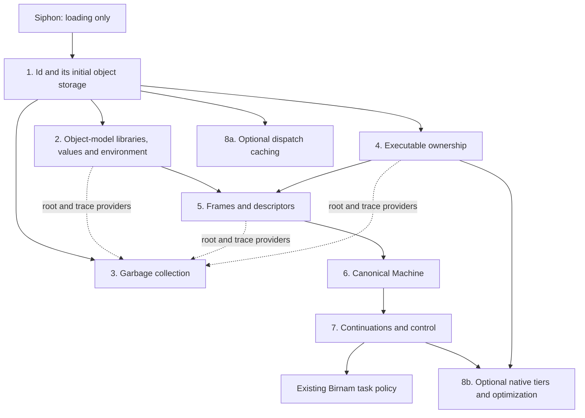

# 81C — Thin layers above Id

> **Current direction:** [Design 82](82-minimal-production-id.md) makes these
> ownership boundaries a production requirement, diagnoses the inverted
> dependencies left by 81J–81CA, and defines the migration and completion tests.

> **Status:** Proposed decomposition, 2026-09-17. Records the user's direction
> to replace thinner layers with Birnam and the clarification that Id is the
> first semantic layer. This does not implement the complete split.
> [Production status](81-production-extraction-status.md) records the closed
> Rust extraction phase through 81CA and the remaining subsystem work.
> Updated direction: extract from Id upward and minimize IdApi without retaining
> backward compatibility; [81D](81d-id-api-partition.md) now proposes the boundary
> against Piumarta and Warth's object model, retaining Symbol/interning in Id.
> Exact interfaces and semantic gaps still require implementation-level review.
> [81A](81a-current-bootstrap-and-runtime-layers.md) describes today's system;
> [81B](81b-siphon-handoff-and-construction-graph.md) describes the siphon handoff;
> [81](../../design/81-toward-a-birnam-implementation.md) owns the broader roadmap.

## 1. Id is first

The siphon loads Id. **No Birnam semantic layer sits underneath Id.** In
particular, there is no hidden Rust allocator, object representation, allocation
registry, dispatch engine or runtime on which the Birnam Id implementation rests.

Id obtains raw storage through platform services and implements the object
storage and bookkeeping needed to construct its own graph. These operations
belong to the loaded Id implementation, not a separate prerequisite runtime.
The OS loader and memory services are platform facilities, not another semantic
rung. The siphon performs loading and handoff only.

The stage-0 compiler may be Rust and may emit C for the initial Id implementation.
The compiled Birnam Id must perform its own runtime work when loaded, without
calling back into that compiler's Rust runtime. This applies to generated helper
functions as well as explicitly authored calls.

The collector is a later layer. Id must expose tracked storage, layouts and root
information sufficient for it to mount without changing existing object
identities. Id does not need to contain the collector's tracing/sweeping algorithm.

## 2. Proposed logical layers

The table is a dependency outline, not a promise that the current source files
already provide these boundaries or that all components form a single chain.

| Layer | Owns | Must not require |
|---|---|---|
| 1. Id object system | Object/behavior association, Object/Symbol/Vtable seed, interning, default lookup/addMethod/allocate/delegated, send/bind and initial storage | Collector algorithm, Frames, Store, compiler or optimizer |
| 2. Object-model libraries, values and environment | Private-vtable/reflection conveniences, Numeric/String representations, language singleton values and raw import/export namespace | Stackless execution or optimization |
| 3. Garbage collection | Root discovery, tracing, sweeping, finalization and collection policy | Direct access to particular higher-level registries or types |
| 4. Executable ownership | Code handles, callable-entry identities, retained owners, leases and retirement | Compiler policy or a particular execution engine |
| 5. Frames and descriptors | Frame storage, typed slots, program counters, descriptor validation and frame tracing | Task scheduling or optimization |
| 6. Canonical Machine execution | Driving Frames, calls/returns, tail calls and synchronous native entry | Optimizing compiler or task policy |
| 7. Continuations and control | Capture/resume, suspension, delimiters, protected boundaries and bounded-driving adapters | Scheduler policy |
| 8. Optimization | Dispatch caches, guarded specialization, native tiers and optimization/recovery plans | Lower layers must work correctly when this layer is absent |

The existing Birnam TaskControl and TaskExecutor then operate above Machine and
control services. This decomposition is focused on today's `libbirnam_id`; it
does not absorb later Prelude, Collection, Store, PEG, Codegen or Image libraries
into Id.

Symbol identity and interning remain in Id; do not construct a second naming
authority when upper services mount. Symbol presentation, export enumeration and
value protocols can mount later. The raw export namespace does not require the
Store-backed `Globals` object, which is a later superimposition. Layer 2 groups
separate logical services, not one compulsory dylib. 81D also separates shared
representation descriptions from collector policy and identifies the default
parent-lookup semantics to examine before extraction.

Executable ownership is the common lifetime mechanism. Resumable manifest
admission and Frame-specific registration sit above it and depend on the relevant
descriptors. This avoids making every code owner depend on the Machine engine.

Optimization is itself more than one optional component. A dispatch cache can
extend Id without the Machine optimizer. Canonical frame/control operations
needed to restore execution belong below optimization; optimizer-specific plans,
guards and reconstruction choices belong above them.

Solid arrows show capability dependencies. Dotted arrows show registrations
with the collector, not permission for GC to depend on those layers' private
representations. The collector must be active before ordinary execution requires
reclamation; a bounded Id construction phase without collection is not a
production memory-management policy.

## 3. Interfaces that make replacement possible

### Storage and collection

Id records allocation ownership from the first object, supplies stable identity,
and supports explicit layout/root discovery and storage reclamation operations.
The later collector consumes these interfaces. Construction roots remain until
normal roots and layouts are established; collector mounting must not leak the
construction heap or move identities to a second object graph.

GC receives root providers and trace descriptions from installed layers. It
must not reach into a shared `Runtime.execution`, optimizer registry or
continuation table. Finalizer detachment, callback reentry and reclamation order
remain explicit. Collector work storage must not recursively require collection.

### Dispatch and extension

Id supplies ordinary lookup/mutation and explicit notifications or checked entry
interfaces where higher layers participate. A synchronous call remains possible
without a Machine. Resumable methods enter the registered execution provider;
Id does not contain its driving loop. Preserve existing lookup effects and native
participation rather than replacing the send contract with a sealed fast path.

Internal observers must coexist with the public method-overwrite hook and Store
mirror. Extracting optimization must not steal a single callback slot or change
observable callback order. Specify the internal fan-out and lifetime contract
before moving these observers into separate modules.

### Executable lifetimes and Frames

Frames, Blocks, continuations and foreign callbacks retain opaque executable
owners. They do not refer directly to TCC units or compiler registries. Shared
ownership must preserve code while any live execution or rollback target needs
it. Frame-specific admission validates descriptors and takes the appropriate
owner reference before publishing a callable entry.

The ordinary loader, compiler and optimizer all use this same ownership
mechanism. Removing optimization must not remove the only implementation of
retirement, code pinning or canonical recovery operations.

### Independent state and minimal interfaces

Each layer owns its state. Cross-layer references use explicit interfaces,
registered providers or owned handles. Splitting dylibs while retaining one
shared mutable `RuntimeState` is not the intended decomposition.

Backward compatibility is not a constraint for this refactor. Remove services
that do not belong in minimal IdApi and migrate their consumers to the relevant
layers; do not retain the old table as a compatibility facade. Id-owned operations
also need justification as direct entries rather than ordinary messages.
[81D](81d-id-api-partition.md) partitions the original 54 fields and identifies
the construction/storage/provider decisions still needed. [81J](https://github.com/chazu/birnam/blob/6339747b7e7b51df74fab518001281322510cac5/docs/design/81j-private-behavior-extraction.md)
began production extraction by removing `ensurePrivateVtable`. After 81J–81CA,
the current [v20 table](../../../abi/idapi-v20.json) has 18 fields / 144 bytes;
[the status page](81-production-extraction-status.md) maps the extracted owners. Do not publish
dummy callbacks to disguise a missing service.

[81E](81e-seed-sufficiency-audit.md) audits the proposed services against the
seed. The five methods alone do not expose all required state and lifetime
operations: behavior reassociation, authoritative seed-state access, storage,
collection attachment, callable ownership and mutation visibility need explicit
contracts. Higher-level reflection can move above Id; the primitive access to
Id-owned state cannot disappear with it. These are interface obligations, not
permission to recreate an aggregate Runtime table.

[81F](81f-isolated-id-seed-proof.md) executes the first bounded witness: a
standalone Rust seed plus separately loaded private-behavior library, with no
production runtime dependency. This establishes that particular interface split.
[81J](https://github.com/chazu/birnam/blob/6339747b7e7b51df74fab518001281322510cac5/docs/design/81j-private-behavior-extraction.md) applies private-behavior extraction to
production while retaining existing collection and lifetime behavior. New
ownership/unloading mechanisms are outside the authorized refactor.

Replacing a layer's implementation at build/startup is the first migration
milestone. Ordinary method replacement must continue to work. Unloading or
exchanging a live heap/collector implementation additionally requires a state
handoff and lifetime proof; separate modules do not make that automatically safe.

## 4. Existing code and Birnam coverage

The main consolidation point is `RuntimeState`/`Runtime` in
[`runtime.rs`](../../../rust/birnam-runtime/src/runtime.rs): symbols, values, vtables,
heap, exports, execution, registration state, caches and native tiers remain
coordinated there, with several backing services now separately owned.
The table identifies remaining integration points, not an untouched monolith:

| Responsibility | Current source starting points |
|---|---|
| Id/object storage | `dispatch.rs`, `vtable.rs`, `heap.rs`, parts of `runtime.rs` |
| Symbols retained with Id | `symbol.rs` |
| Values and environment | `values.rs`, `env.rs` |
| Collection of memory | `gc.rs`, allocation/collection coordination in `runtime.rs` |
| Registration and ownership | `registration.rs`, staged/committed unit and lease state in `runtime.rs` |
| Frames and Machine | `execution.rs`, `execution/*`, `run_stackless_loop*` |
| Control adapters | `runtime/task_control.rs`, `runtime/scheduling.rs`, execution boundaries |
| Optimization | `runtime/native_tier*`, `runtime/numeric*`, dispatch/lookup guards and recovery consumers |

There is no complete Birnam allocator, collector, interner, Id dispatcher or
Machine engine ready to substitute for these today. Birnam already implements
derived value/library methods, task/cancellation/cleanup policy, and compiled-unit
and generation policy. These are consumers of the mechanisms, not redundant
implementations of them. The native loop/iteration methods replaced by
`stackless-control.birnam` mostly come from Prelude/Collection, not libid itself.

## 5. Target dependency order (future work)

**Construct the target from Id upward.** The preparatory extraction phase is
closed at 81CA. The sequence below describes eventual subsystem boundaries; it
is not a requirement to wrap every remaining field before writing Birnam.
The dependency order starts at Id, rather than optimization.

1. Partition IdApi, minimize its construction/dispatch contract, and move unrelated
   services to their actual owners. Update consumers rather than preserving the
   aggregate ABI.
2. Extract Id-owned storage, identity, vtables and dispatch from RuntimeState.
   Resolve upward dependencies through explicit provider interfaces and prove
   ordinary Id operation without values, collection, execution or optimization.
3. Extract object-model libraries, values/environment and collector services
   above Id. Preserve initial object/selector identities and mount GC through
   storage and root protocols.
4. Extract executable ownership, Frames/descriptors, Machine execution and
   control, then optional optimization and its compiler/libtcc dependencies.
   Resolve publication and lifetime requirements at each boundary.
5. Replace the resulting thin implementations with Birnam in dependency-informed
   slices. A layer can migrate while its neighbors are still native; that is
   an intermediate development system, not the completed stage-1 target.

Mechanical Rust extraction makes later replacement possible; it is not itself
self-hosting progress. The stage-0 tool remains available throughout. The
experimental Birnam Id construction track in 81B can proceed independently as
the compiler facilities become available; it need not block useful bottom-up
extraction in the existing runtime.

Acceptance should show each lower layer operating without the extracted upper
layer, ownership and mutation behavior across the boundary, and eventual removal
of the replaced Rust implementation from the installed execution path. Use
existing semantic/ABI/lifetime checks and representative performance evidence;
separate correctness from timing claims.

[81L](https://github.com/chazu/birnam/blob/6339747b7e7b51df74fab518001281322510cac5/docs/design/81l-production-integer-extraction.md) extracts the production Integer
family, primitive operations and methods. Its explicit native dependency reduces
IdApi v4 to 45 fields / 360 bytes. The remaining Machine and optimizer components
consume that dependency; the host and those runtime components are still Rust.
Focused validation passes; release validation was explicitly waived.

[81M](https://github.com/chazu/birnam/blob/6339747b7e7b51df74fab518001281322510cac5/docs/design/81m-production-storage-observation.md) adds protected production storage
facts and a separately loaded description validator. GC policy, native-root
capture and legacy tracing remain in the current runtime; their coverage gaps
are explicit. [81N](https://github.com/chazu/birnam/blob/6339747b7e7b51df74fab518001281322510cac5/docs/design/81n-production-storage-tracer.md) adds the loaded scoped graph
tracer, with strict coverage by default. Production root/provider migration and
collection remain separate; the automatic mark path is still inside Id.

[81O](https://github.com/chazu/birnam/blob/6339747b7e7b51df74fab518001281322510cac5/docs/design/81o-production-live-gc-traversal.md) subsequently removes Id's worklist:
production collection now uses the loaded live tracer. Source policy adapters,
collection coordination and physical reclamation remain to be extracted.
