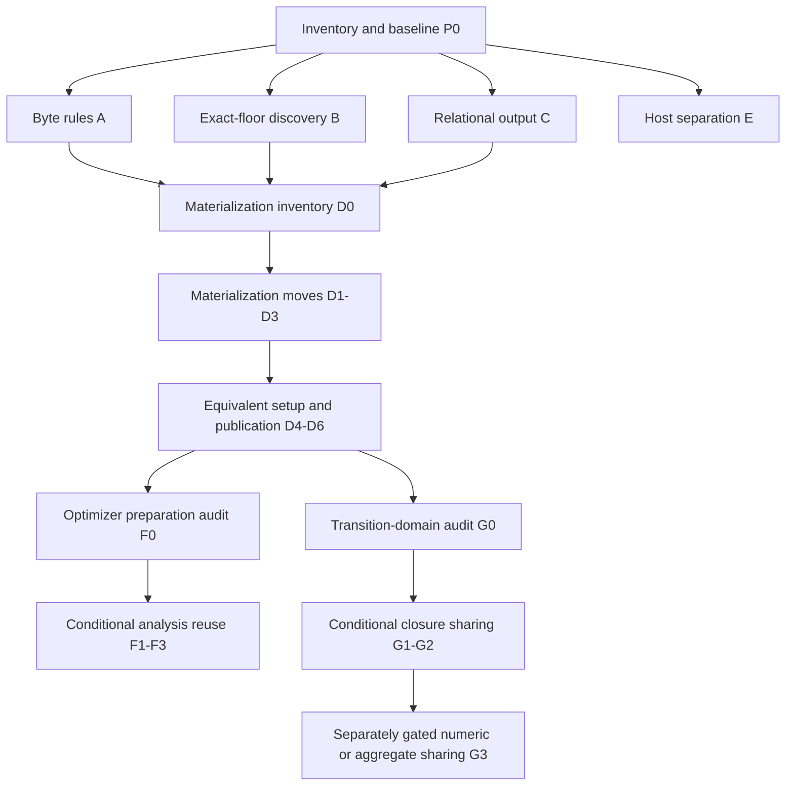

# 79 — Refactoring implementation plan

> **Status: implementation plan; adversarial review complete, 2026-09-15.**
> Prepared against `b8d9f255` and the uncommitted Designs 78/78A. The user
> initially authorized planning and adversarial review. Implementation was
> subsequently authorized on 2026-09-15; progress and evidence are recorded in
> [79B](79b-refactoring-delivery.md).
> Validation scope was reduced by explicit user direction during implementation:
> use the change-focused acceptance in section 5, not a full release matrix.
> The user subsequently accepted the delivered scope and documented deferrals as
> complete. See 79B for the final scope and validation limits; unimplemented rows
> below are future options, not outstanding requirements of the completed batch.
> This document schedules no deployment, commit, tracker transition or default
> promotion. Its commit labels are proposed work units, not completed work.

## 1. Problem and intended outcome

Repeated byte rules, unsafe loader mechanics and native output writing make
small changes span several callers. Materialization and host code concentrate
multiple responsibilities while scattering their ownership rules. Optimizer
composition repeats compiler analysis and recovery transition mechanics.

Implement the bounded proposals in [78](78-invariant-preserving-refactoring-review.md)
subject to its complete invariant ledger and the three adversarial findings
resolved in [78A](78a-refactoring-adversarial-review.md). The outcome is one
implementation for proven-equivalent mechanics, clear state ownership and
smaller review surfaces, with the same malleable language and current contracts.

The deliverable is organized into independently verifiable series. Do not turn
the entire plan into one refactor or use successful early series as permission
to bypass later investigation gates. Each commit must compile and pass its
focused checks; each completed series must pass its acceptance tier before it
is presented as ready to land. Commit count is a guide: split a row further if
review reveals distinct lifecycle or caller behavior. Do not squash away the
separation between characterization, moves and changed internal costs.

## 2. Frozen scope and decisions

### Implementation decisions

- Share byte classification through the existing provider-free Artifact module
  and source literal-body decoding through pure Codegen. Cross-crate helpers
  may need Rust visibility within the existing workspace; existing Rust caller
  contracts, Birnam methods, C exports and runtime ABI remain unchanged.
- Put only exact-image acquisition mechanics in a stateless ABI utility module.
  The TCC, Codegen and Image adapters keep their own caches, lookup invocation,
  loader references and error policy.
- Keep relational native output as a raw-pointer adapter operation after all
  callback-capable collection and input reads. Separate extraction from optional
  clone removal. Keep pure evaluation separate from native representation.
- Give materialization code ownership of the state it already manages, using
  private modules inside the existing Codegen-runtime crate. Keep root-provider
  registration count/order, per-registry synchronization and singleton scope.
  The floor decides retirement eligibility; TCC owns executable storage.
- Preserve the host's coordinating interface and address identity. Separate
  command parsing, project data/workflow and startup using private modules with
  existing public re-exports; keep Birnam-authored policy in Birnam.
- Reuse immutable compiler analyses only during their existing bounded
  preparation lifetime. Keep checked callers, live guards and family gates.
- Share transition mechanics between closure analyses first. Numeric and
  aggregate transitions remain separate until equivalence on each caller's
  admitted layouts has evidence. A canonical-only gate is forbidden for the
  currently broader public aggregate derivation interface.

### Invariants and exclusions

All Design 78 ledger rows are mandatory. In particular:

- no sealed selectors, frozen Machine overrides, new lookup effect, stale
  target cache, effect replay or new native-metadata requirement;
- no changed identity, allocation charge, GC/finalizer observation, continuation
  semantics, bounded resumable native stack, root or generation ownership;
- no new ABI/format, altered default/admission/refusal policy, eager disabled
  family preparation, global analysis cache or new retention/accounting rule;
- no new native-output non-aliasing/alignment/initialization/extent requirement;
- no shared implementation between production logic and independent oracles;
- no worker `_private` arity correction, Linux port, concurrency redesign,
  compiler policy migration, general optimizer framework or unrelated lint sweep.

A discovered behavior inconsistency is recorded separately. Preserve it during
extraction or leave the affected caller unchanged. This plan does not authorize
fixing it by changing the implementation or its reference oracle.

## 3. Order, dependencies and gates

The arrows from A/B/C to D0 and from D6 to F0/G0 specify the recommended delivery
order, not technical dependencies. B's helper is a real dependency only for a
D cleanup that uses it. E can run after P0 independently, but edits to host,
Codegen-runtime and validation fixtures must have one owner at a time. Do not
run concurrent validation plans that share this checkout's build/prefix state.
G does not require F and must not inherit F's canonical-layout restriction.

An investigation gate has three outcomes: evidence supports the bounded next
step; a smaller scope preserves behavior; or the change is deferred with the
reason recorded. An open gate is not an implementation ticket ready for an
unattended agent. No invariant or acceptance threshold may be weakened to close
it. Deferring a conditional change does not count as implementing it.

## 4. Commit plan

### P0 — Establish the execution baseline

One planning/evidence commit when implementation is authorized:

- Re-read current instructions, HEAD, dirty paths and the local Beads location.
  Preserve the existing document work. Record the actual source revision and
  source manifest used for each series; this plan's old baseline is not enough.
- Map every affected public/native/generated caller before editing. Record
  signatures, accepted inputs, errors, observation points and existing fixtures.
- Preview the current routine/exhaustive/release plans. Reuse only evidence
  whose inputs, configuration, dependencies and artifacts still match. Otherwise
  run the required baseline subset before changing its implementation.
- Keep build prefixes and raw evidence in disposable or `.cargo-target` storage.
  No user installation is needed. Record native binaries and the selected floor
  used by each test so the installed path cannot silently test stale code.

Acceptance: the series has a reproducible reference, a caller inventory and a
named test map. Missing coverage is listed as a required characterization step,
not hidden behind the baseline's overall passing status.

### A — Language-byte mechanics (R1)

| Commit | Deliverable and limit | Focused proof |
| --- | --- | --- |
| A1 | Characterize the existing unchecked arity callers and three literal callers through their current interfaces. Add only missing expected-value/byte cases. Freeze host `_private` behavior without correcting it. | Unary/underscore/binary/keyword/empty/non-ASCII inputs; literal envelopes, all byte escapes, unknown/trailing escapes and NULs; exact generated C and portable bytes. |
| A2 | Add the pure total arity operation in provider-free Artifact and switch the equivalent pure Codegen caller. Preserve nonallocating operation and return domain. | Codegen's real emission tests and A1; provider-free build without enabling a runtime provider. |
| A3 | Switch equivalent Codegen-runtime and portable-code unchecked callers. Leave all checked format readers and the host predicate untouched in this series. | Relevant crate tests and native/source language entry. Source audit confirms the exclusions. |
| A4 | Extract literal-body decoding and convert pure Codegen emission/portable encoding together; keep envelope validation and C escaping at their existing callers. | A1 exact-byte corpus, malformed-envelope differences and deterministic emission. |
| A5 | Switch the runtime literal caller to the same body decoder, preserving its `None`/error adaptation and allocation capacity behavior. | Runtime source metadata/embedded-path callers plus the byte corpus. |

The checked readers' `usize`/`u32` conversions, nonempty-name preconditions and
independent format validation are not folded into the unchecked operation.
For example, the private Frame/manifest arity helpers classify empty input
differently from the compiler's total helper. Leaving them untouched avoids
assuming their caller validation makes every internal behavior interchangeable.

**Series acceptance:** section 5's shared baseline, focused byte/emission tests
and provider-free dependency/export checks. A bootstrap dependency change needs
the affected bootstrap check. No performance claim is planned.

### B — Exact-floor discovery (R2)

| Commit | Deliverable and limit | Focused proof |
| --- | --- | --- |
| B1 | Build or extend a real native-loader fixture that distinguishes selected local floor from a competing same-symbol library. Record successful/failed acquisitions, symbol calls and retained references per existing adapter. | Fresh processes isolate each `OnceLock`; repeated success, failed acquisition and missing symbol preserve callback counts and negative caching. |
| B2 | Move only `DlInfo`, target flags and address-to-library acquisition into ABI utility code; convert TCC registration lookup first. Keep its static cache and typed conversion at the caller. | B1 plus ordinary TCC registration/native export audit. |
| B3 | Convert TCC retirement lookup to the same acquisition mechanics. Preserve its own per-symbol cache/reference ownership. | B1 retirement and missing-symbol cases; generation retirement behavior. |
| B4 | Convert Codegen's handle-cached path without introducing symbol-result caching or automatic close. | Repeated lookup traces, selected-floor binding, materialization/lifetime fixtures. |
| B5 | Convert Image's handle-cached path. Remove only the now-unused duplicate loader declarations. | Image load/rebuild, missing symbol, mapped-carrier lifetime and relocated prefix. |

No safe destructor is introduced for intentionally retained handles. The fixture
must exercise the actual adapters. Discovery uses the address of `IdApi.dlsym`
as selected-image authority, so installing a host-side wrapper there changes the
image being tested. Instrument without changing that owning image: use separate
fixture floor dylibs whose exported `dlsym` trampolines live inside each selected
image and forward real handle-based lookup, or preserve the actual normal-floor
function address while observing its calls. Do not substitute global lookup.

B1 must assert the image owning the supplied function pointer, the requested
path/handle and the distinct returned symbol for each competing library. Keep
fresh processes for every negative-cache case. Retained-reference checks must
not keep a harness-owned reference alive across an unload assertion and thereby
mask a premature release. Fixture capability traces supplement normal-prefix
native/image tests; they do not replace ordinary-floor acceptance.

**Series acceptance:** section 5's shared baseline, B1 and normal-floor native
checks. Confirm provider export/dependency surfaces and frozen authorities.
Image migration is deferred in this delivery because its source is frozen.

### C — Relational output and evaluator (R3)

| Commit | Deliverable and limit | Focused proof |
| --- | --- | --- |
| C1 | Add missing native-adapter characterization for the ten result writers. Record the actual pointer validity contract per caller and capacity/error behavior. | Whole-result capacity refusal; sentinel output/`written`; zero capacity/null output; initialized record fields; String lengths; competing errors; permitted input/output overlap and callback-before-write trace. |
| C2 | Extract output writing and convert one representative projection path with existing cloning/conversion preserved. Keep early argument checks at the caller and writer entry after collection, input parsing and complete evaluation. | C1 through the actual adapter; callback and overlapping-input fixture remains valid. |
| C3 | Convert remaining projection/window/join/predicate/negation/disjunction/recursive/rule paths individually; group only paths with the same publication behavior. | Per-path C1 cases, native return/status order, query ordering/equality tests. Split into several commits if more than one behavior group appears. |
| C4 | Audit clone allocations; only then replace owned-value copying with borrowing in record conversion. Keep this an isolated internal-cost change. If allocations participate in an admitted semantic/accounting/failure contract, leave them intact. | Rust-versus-Birnam allocation provenance, unchanged native records, Birnam allocation/callback/root traces and C1. No benchmark-based waiver of semantics. |
| C5 | Move pure query/value/rule evaluation with existing semantic tests into its own module; retain public re-exports and leave all native adapters/root globals in place. | Existing query matching, deduplication/order, recursive rule/fixpoint and cache-rebuild tests. |
| C6 | Move native Store collection and output adaptation into private adapter modules, keeping the same roots, symbols and call order. Update module summaries to describe current ownership. | Native adapter/Store callbacks and language-level relational suites. |

C4 is conditional and may be deferred without blocking C5/C6. Do not stream
output before total capacity is known, set `written` on entry, or introduce
exclusive output references while callbacks/input reads can still access it.

**Series acceptance:** section 5's shared baseline and C1's native-adapter matrix;
native export layout unchanged. No query optimization is included. A source count
of removed clones is not a timing result.

### D — Materialization ownership (R4)

This series has a mandatory inventory gate before production edits. It must
preserve observable root registration/traversal and callback/lock behavior even
when private Rust modules change.

| Commit | Deliverable and limit | Focused proof |
| --- | --- | --- |
| D0 | Write the per-path ownership/failure inventory below and close missing characterization cases. Inventory synchronous, named, resumable, mapped/rebuilt image, publication and eviction entry paths, including all registry access sites. | Every failure exit links to an existing case or a new bounded failure injection; baseline native/no-metadata, reentry and old-code retention cases pass. |
| D1 | Move materialization-cache storage, operations and its root-visitation segment together. Existing root callback delegates at the same position; keep each lock and traversal order. Do not move unrelated root registries. | Root traversal/registration counts; cache age/limits; staging failures and eviction. |
| D2 | Move CodeBinding storage, lifecycle operations and its root-visitation segment together. Adapt image/publication callers through narrow private operations, retaining lock boundaries and compensation order. | Staging/current/retiring counts; target/provenance identity; image binding install; callbacks outside locks; reaping only after floor confirmation. |
| D3 | Move the three materialization implementations and plan state into the owning module, one path per commit if necessary. Move bodies without introducing extra send wrappers, earlier drops or new cleanup policy. | Path-specific D0 cases, nested Block/Frame retention, evaluator roots and generated-code bytes. |
| D4 | Consolidate compile/bind/relocate setup only for transitions the inventory proves equivalent. Keep path-specific registration, cancellation, publication and disposal explicit. | Failure injection at each merged stage; compare exact callback/effect trace, roots, cancellation and native release. Leave non-equivalent paths separate. |
| D5 | Extract publication/recovery orchestration with candidate/prepared/transaction state and their root-visitation segments as independently reviewable moves. Each registry has one owner; no parent/child module directly mutates another's registries. | Candidate activation, Store compensation, rollback, image recovery, retained generations and failure ordering. Split by state owner; do not create one omnibus lock. |
| D6 | Separate source/emission and reflection entry methods from publication/materialization. Preserve export registration/order, ordinary sends, frozen wrappers and the existing public Rust/native surface. Update ownership summaries. | Source/CST/embedded-file semantics, deterministic emission, reflection/MOP behavior and the complete D0 caller inventory. |

D0's required table columns:

- entry path and exact stage/failure trigger;
- Unit/generation owner, native allocation owner and current registration state;
- every live Oop/root provider/cache lease and the safe-point handoff;
- locks/borrows held, and which operations can send, allocate, collect or reenter;
- compensation/retirement authority, action order and physical release condition;
- effect/root/lifetime assertions, test entry point, build/profile and receipt.

The D1/D2 interfaces transfer or report existing data; they do not create a
single lock around the entire lifecycle. Preserve whole-callback exits and
mutex-poison/failure behavior as well as normal traversal order. In particular,
`mark_live_units` currently returns from the entire root callback if locking
`MODULE_SOURCES` fails. Replacing that with a helper-local return would continue
into later root visits and is not a mechanical extraction; the delegated segment
must preserve the enclosing callback's decision without changing lock policy.
No scope guard may call fallible compensation during Rust destruction. Moving an Oop out of a native stack extent
can change conservative reachability; precise/conservative GC and the ownership
inventory must establish real roots rather than relying on a "move-only" label.

The native fixture must include a handwritten Method with no compiler recovery
metadata, one external effect per call, callback reentry, replacement affecting
the next send, and active old-code retention. Preserve barriers and bounded
resumable stack behavior. An effect counter and correct final value alone do
not prove all of those properties.

**Series acceptance:** section 5's shared baseline and evidence for the ownership
actually moved. D1/D2 require the state/root characterization and existing native
lifecycles. Broader moves remain gated by the complete D0 failure/lifetime matrix.
No remaining direct registry manipulation across the
new ownership seam; no unsourced root or native owner. D4 may remain partial
where behavior differs; D5/D6 must not depend on forcing those paths to merge.

### E — Host separation (R5)

| Commit | Deliverable and limit | Focused proof |
| --- | --- | --- |
| E1 | Move command types/parsers and matching tests into a private command module; retain public re-exports. | Existing parser/default/error tests, including error-before-runtime-access. |
| E2 | Move pure project-data validation, dependency order and publication-source construction with their tests. | Exact project source/digest output, malformed data and diagnostic precedence. |
| E3 | Move Git/cache acquisition and publication filesystem operations with existing rollback behavior. | Offline and malformed cache behavior, publication success/failure/rollback, unchanged successful publication after failure. |
| E4 | Extract project orchestration and native bridge functions without changing `HostRuntime` representation, construction, address, installation point or `Drop` behavior. | Actual bridge callback, matching-address clearing, failed startup, project build/check/test/run/install. |
| E5 | Separate library/resource/startup/worker/REPL implementation and corresponding tests; keep the coordinating object and its ownership order unchanged. | Relocation/clean environment, worker startup, REPL and module errors, native handles and GC anchor lifetime. |

Do not box, move, pin or reallocate `HostRuntime` as part of these module moves.
A discovered existing pointer-lifetime issue must be separately reported. The
first source-independent project-run test corrupts/removes authored input after
a successful build and checks ordinary run/install still use that publication.

**Series acceptance:** section 5's shared baseline and explicit host project/bridge
tests. The project workflow fixture remains necessary for the project moves.

### F — Conditional compiler-analysis reuse (R6)

| Commit | Deliverable and limit | Focused proof |
| --- | --- | --- |
| F0 | Inventory repeated lowering/coloring/template calls, checked caller domains, size/family gates, owned allocations and lifetimes. Record counts/costs through representative accepted, disabled and refused production preparation paths. | A reuse target exists within one preparation extent and does not cross live authority or accounting. No retained-byte limit or refusal threshold changes. |
| F1 | Add a private immutable analysis owner in pure Codegen and convert one composed caller, initially numeric closure-body template/maps preparation. Existing checked entry points preserve validation/refusal and raw-input contracts. | Mismatched program/layout rejection, unchanged admitted/refused cases, equal plans/emission, same lifetime and retained accounting. |
| F2 | Convert ordinary numeric/unboxed preparation to reuse only already-required analysis; keep disabled-family laziness and exact runtime guards. | Disabled/no-plan, refused/partial/accepted paths, live API/method mutation, preparation ceilings and teardown. |
| F3 | Convert closure preparation only if F0 demonstrates the same lifetime/validation relationship. Keep a separate wrapper where it does not. | Closure layout corruption, mutation/capability callback order, identity/control/recovery and lifetime matrices. |

F0 can conclude that extraction offers too little benefit or would change
retention/accounting. In that case retain the duplicated validation. Existing
public aggregate derivation is excluded from F. A cached compiler proof never
replaces the live send/constructor/API/lookup guard that admits execution.

**Series acceptance:** section 5's shared baseline and F0's paired
preparation/refusal/lifetime evidence using the revision comparison below.
Improvement is not assumed, no default is promoted, and no full profitability
research is required merely for file moves.

#### F0 revision-comparison protocol

The generic `mise run verify-performance` task compares aggregate switches off/on
within one revision. It does not compare a refactor with its predecessor and can
pass without exercising numeric or closure preparation. It is supplementary,
never F's acceptance evidence.

F0 must retain a baseline source snapshot before F1 and implement a bounded
comparison using the existing benchmark/validation support. Run the identical
fixture/harness bytes against baseline and candidate normal release prefixes,
each built and provenance-checked against its own source snapshot. Use separate
checkout/prefix roots so a current-source checker cannot accidentally bind an
old baseline binary to candidate sources. No source checker is disabled. Record
both source manifests, compiler/configuration, artifact hashes, explicit switch
values, fixture hashes and the comparison's input/output assertions.

Freeze at least these configurations before F1: ordinary defaults; every affected
family disabled; enabled successful numeric preparation; enabled successful
numeric-closure composition; early/late refusal; and the existing preparation
size/budget limits. Select concrete fixtures from the current numeric and closure
timing/semantic harnesses. Require positive preparation/admission markers for
the successful cases and exact refusal/no-preparation markers for the others.
A flag being set or an answer being correct does not establish path coverage.
Diagnostic counts are separate runs tied to the same production source, not
timing samples; they must prove that the analysis being removed was executed.

For numeric and closure experiments, explicitly record `unboxed` and/or `closure`
switches and their environment values; include other switches only where the
affected composed caller requires them. Generic application scenarios remain
useful controls but cannot replace targeted preparation fixtures. Preserve the
existing defaults and resource accounting in every comparison.

Use three alternating baseline/candidate pairs per frozen cost case, with the
same configuration on both revisions. Retain preparation time separately from
execution/process time, derivation counts, peak/live transient storage where
instrumentable, retained bytes, and final teardown ownership. Peak RSS is only
supplementary process evidence; it does not establish registry budgets or exact
retained-byte accounting. If the required lifetime/accounting evidence cannot
be collected, keep that reuse step deferred. Mark measurements unqualified.
Use the current practical screen's rule to flag a revision slowdown: median
increase above 5% with at least two of three pairs above 5%. A flagged case keeps
the cost-changing step unaccepted pending investigation or a narrower reuse;
do not retry until favorable, promote defaults, or treat an existing off/on
slowdown as a newly introduced revision regression. Semantic/accounting failures
fail regardless of timing. Unavailable or unexercised targeted evidence leaves
the relevant F step deferred, not accepted.

### G — Conditional recovery-transition sharing (R7)

| Commit | Deliverable and limit | Focused proof |
| --- | --- | --- |
| G0 | Produce an admitted-domain/transition table for all four analyses. Establish closure equivalence first; document bounds, missing bitmap words, result/clear ordering and outside-layout behavior. | Existing independent interpreter/Frame comparisons plus explicit expected transitions, copy cycles, clear/result overlap and accepted noncanonical aggregate cases. |
| G1 | Extract closure-only pure transition mechanics and convert the first closure analysis. Keep its validation, alias domain, result semantics and failure adaptation outside the shared operation. | G0 expected cases and actual closure Frame comparison. |
| G2 | Convert the sequence analysis only after equivalence over its reachable layouts is established. Keep missing-word behavior where its entry contract permits it. | Sequence sizes/exits, forced recovery, mutation, allocation/GC and capture/suspend/resume in both GC modes. |
| G3 | Independently consider numeric and aggregate callers, one at a time. Reuse only mechanics proven equivalent on each existing admitted domain; otherwise leave them separate and document why. | Noncanonical aggregate admission/output preserved; numeric result publication ordering preserved; no shared canonical gate or new panic/refusal. |

No interpreter, fixture decoder or expected-result generator calls the new
production helper. Do not change driver/descriptor/root-map semantics to make
sharing possible. Failing G0 is a valid reason to stop this series; it does not
block A–F.

**Series acceptance:** section 5's shared baseline, G0's domain tests, and targeted
sequence/mutation checks. Resource changes require the affected accounting/lifetime
checks. Unchanged numeric/aggregate families do not require full matrix sweeps.

## 5. Testing and evidence execution

### Change-focused acceptance — revised during implementation

The user explicitly rejected the 84-step release run as excessive for this work.
The refactor uses four groups of evidence, once on the combined candidate:

1. Rust workspace tests, including focused compiler/byte/transition tests.
2. The Birnam language suite against the existing candidate prefix.
3. Tests for changed boundaries: loader selection, relational FFI output,
   cache/binding roots, host bridge and project workflow.
4. Existing normal native lifecycles for malleability, replacement/retirement
   and image behavior, plus targeted sequence/mutation checks for G.

Reuse already-passing checks whose source and artifacts still match. Preserve
the frozen ABI/Image authorities. Add a further check only for a specific changed
behavior, failure, or unresolved invariant concern; document what it resolves.
Full debug/release optimizer matrices, performance sweeps, repeated cold builds
and supplemental lifetime sweeps are not automatic refactor requirements.
The repository's full release tools remain available for release qualification.
The interrupted release run is incomplete and is not relabeled as a release pass.

### Existing entry points verified during planning

These commands are evidence routes, not assertions that coverage is already
complete. Use the current help/plan at execution time and retain the actual
expanded commands in the receipt.

| Coverage | Entry point / current prerequisite |
| --- | --- |
| Focused Rust behavior | `cargo test --locked --offline -p <affected-crate>`; use the pinned toolchain and checkout's task target directory. Follow with workspace tests before series acceptance. |
| Full language behavior | `BIRNAM_TEST_PREFIX=<fresh-private-prefix> mise run test`; confirm the prefix's source/configuration receipt. |
| Current plan and named dependencies | `python3 scripts/validate.py --suite <routine|exhaustive|release> --plan`; named `--only` checks include declared prerequisites but are not a complete-suite receipt. |
| Everyday / exhaustive / release | `mise run verify`, `mise run verify-exhaustive`, `mise run verify-release`; release includes exhaustive, native audits and two independent cold-source installs/relocations. |
| Project workflow | `BIRNAM_BIN=<fresh-private-prefix>/bin/birnam mise run rust-project-check-smoke`; the script requires `BIRNAM_BIN` explicitly. |
| Native binding/image/control | The plan's `native` step runs the installed native driver, which invokes portable CodeBinding, resumable/image-v8, stackless control and ordinary native fixtures against the selected prefix. |
| Evaluator/native storage | Plan steps `evaluator-lifetime` and `baseline-native-storage`, with their generated diagnostic prerequisites. Do not hand-invoke a diagnostic script against an ordinary uninstrumented library. |
| Practical cost screen | `mise run verify-performance` is an aggregate off/on screen within one revision; supplemental only. F0 defines the required affected-path baseline/candidate comparison. Neither claims qualified speedup. |

The baseline routine plan does not automatically execute every standalone script
named in Design 78. P0/D0 must inspect actual plan membership and coordinate
assertions before counting a fixture as covered. In particular, old Unit-cache
or resource receipts are useful references, not automatic proof of a changed
materialization owner. Use the script's actual CLI/prerequisites or add a bounded
new case to the existing integration route when coverage is missing.

### New proof obligations and wiring

Each missing test is implemented in the characterization commit before the
production change it guards. Prefer existing production entry interfaces and
fixtures; do not add private-helper mirror tests solely because a file moves.
Expected values/bytes/traces come from an independent oracle or explicit cases,
not from running the new helper on both sides.

- A: byte/arity caller differences and deterministic output.
- B: fresh-process loader selection, failure cache and callback/refcount traces.
- C: actual FFI adapter aliasing, output sentinels and callback/write order.
- D: ownership/failure table, arbitrary native/no-replay, old-code retention,
  root/reentry and actual physical release.
- E: source-independent project workflow and bridge address/cleanup behavior.
- F: checked caller domains, lazy preparation, live guards and resource bounds.
- G: accepted-domain equivalence and independent physical transition outcomes.

Wire new durable regressions into the existing appropriate crate or validation
plan in the same characterization commit. Include every new fixture/harness
source in that step's input hashes, prerequisites, relevant CI selection and
artifact assertions; reuse the existing validation support rather than a new
controller. Validate orchestration changes with the tool tests. Merely storing
a manual log does not ensure the test remains exercised after the refactor.

### Cost and repetition rules

Run affected checks as changes are made, then the shared acceptance once on the
combined source. Do not multiply full suites by series or automatically promote
a refactor to release qualification. Reuse only validated matching evidence;
changed source, input files and build configurations invalidate affected results.

Record normal and diagnostic builds separately. Select diagnostic cases only
when they resolve a concrete concern in the changed code; installed normal-prefix
evidence and ABI/export checks use normal builds.

Current default deadlines are 15 minutes for routine and 30 for exhaustive/
release. A timeout is incomplete. A larger explicit execution budget or resumed
unchanged evidence may finish it; shrinking the matrix, changing semantic
assertions, changing defaults or substituting an older source cannot.

## 6. Completion, recovery and handoff

For each series, retain a compact completion record with its actual commits,
source/artifact hashes, changed/retained callers, invariants checked, expanded
test commands and receipt paths. State any deferred conditional commit explicitly.
The record must identify whether it is ready for review, accepted locally, landed,
or installed; those are different outcomes.

If a commit changes behavior unexpectedly, stop dependent work, preserve its
failure evidence and return to the last passing checkpoint using a scoped
follow-up/revert of that series when authorized to implement. Never reset or
clean unrelated dirty files. Avoid unrelated fixes in a refactor diff; a narrower
extraction is preferable to changing an invariant or weakening its test.

Beads remains the repository's authoritative execution tracker. This planning
turn does not create implementation-ready tickets or alter existing performance
dependencies. When execution is requested, represent selected series and their
investigation gates there; preserve the distinction between a completed plan,
a passed gate, implemented code and accepted final evidence.

Overall implementation is complete only when the selected unconditional series
are accepted and every selected conditional step is either implemented and
validated or explicitly reported as deferred. A deferred step is not reported
as a delivered optimization/refactor. No whole-runtime speedup is claimed by
this plan, and no project invariant is amended.

## 7. Adversarial review

An independent agent reviewed sequencing, crate dependencies, ownership moves,
FFI test validity, actual validation scripts and invariant preservation, then
reread the revised plan. The full record is
[79A — Implementation-plan adversarial review](79a-implementation-plan-adversarial-review.md).

| Finding | Resolution |
| --- | --- |
| Loader instrumentation could change the selected image by replacing `IdApi.dlsym` with a host wrapper. | B1 requires image-owned trampolines or address-preserving observation, verified selected-image/handle/symbol identity and normal-floor acceptance. |
| Generic performance screening could miss numeric/closure preparation and compares switches within one revision. | F0 requires affected-path counters, explicit configurations and matched baseline/candidate source/prefix comparisons with separate preparation and lifetime evidence. |

The reviewer found both material findings addressed and no remaining material
objection to the plan. The root-callback whole-function exit/lock-failure
constraint was also made explicit in D. This is plan acceptance only: no
implementation, invariant equivalence, runtime test or performance claim is
qualified by the review.

Planning verification: all named validation steps were found in the current
79-step release-plan preview; local Markdown links and whitespace checks pass.
No production source, validation scripts, user installation or tracker state was
changed. Existing uncommitted review documents were preserved and cross-linked.
