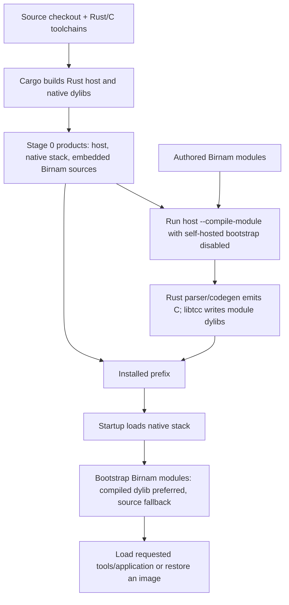

# 81A — Current bootstrap and runtime layers

> **Status:** Production inventory refreshed through 81CA (`ad9557fb`) on
> 2026-09-20, with source and retained debug-install receipts checked at
> `e928780c`. See the [phase closeout](81-production-extraction-status.md).
> Stage describes how a product is built; it does not describe its implementation
> language. The installed host and native runtime/compiler are still Rust.

The install contains 53 canonical native Birnam libraries and 28 libraries
compiled from Birnam source: 81 `libbirnam_*.dylib` files in total. Optional
wrapped C libraries are counted separately. IdApi v20 has 18 fields / 144 bytes;
ordinary native initialization receives twelve arguments, and images use v8.
The original 21-library/v4 snapshot is preserved in Git history.

Extraction moved value families, namespaces, GC services and several backing
stores into loaded Rust modules. Id retains physical allocation, dispatch,
metadata retirement, Frames/Machines, native-tier decisions and executable
lifetime integration. Those remaining responsibilities have not been rewritten
in Birnam. Debug startup and compiled-image validation are recorded in the
closeout; release validation was explicitly waived.

[View the startup diagram (PNG)](../diagrams/birnam-startup.png) ·
[Scalable SVG](../diagrams/birnam-startup.svg) ·
[Editable Graphviz source](../diagrams/birnam-startup.dot)

## 1. Stage means build stage, not runtime layer

Today stage 0 is the externally built Rust host and native library stack,
including the complete Rust compiler and embedded Birnam bootstrap sources.
Stage 1 runs that host to compile authored Birnam modules into installable
dylibs. The installed system combines both sets of products.

**Stage 1 does not rebuild the compiler, host, or native rungs in Birnam.**
There is no stage-1 Birnam compiler replacing a stage-0 Rust compiler, and no
second host executable emitted by the Birnam compiler. The executable copied
from the Cargo build is also the installed executable.

The subsequently clarified [stage-1 requirement](81-toward-a-birnam-implementation.md#installed-stage-1-requirement--clarified-2026-09-17)
requires an installed siphon that brings up Birnam implementations from modules,
images and source, without calling statically linked Rust system behavior. This
inventory records current behavior and the native dependencies to migrate.
Retained source and source fallback are intended; their presence is not a defect.

[81C](81c-thin-id-runtime-layers.md) proposes splitting the current libid into
thinner replaceable layers, starting with Id as the first semantic layer. The
following inventory describes the remaining combined floor and its extracted
production dependencies.

Separately, either that executable's source-fallback startup or an installed
startup builds a layered object environment. Later modules install or replace
methods in this environment. Build stage, implementation language, execution
representation, and runtime load time must be recorded separately.



## 2. Build-time sequence

The authority is [`birnam-build.rs`](../../rust/birnam-build/src/main.rs),
entered through [`scripts/rust-install.sh`](../../scripts/rust-install.sh).

1. The shell wrapper runs Cargo to build/run the Rust `birnam-build` driver.
   A cold install uses fresh target directories; `--build-cache` explicitly
   permits development reuse. Both Cargo invocations use `--offline --locked`,
   so the declared toolchains and dependency sources must already be available.
2. The driver builds the Cargo workspace, then copies `birnam` and 53 canonical
   native dylibs into a staging prefix. Those are the floor plus 52 rungs in
   section 3. Optional existing linenoise/termbox2 dylibs are copied too.
3. For each of the 28 `STAGE1_MODULES`, the driver launches a fresh staged
   `birnam --compile-module SOURCE OUTPUT` process. It clears the environment
   and supplies PATH and the staged `BIRNAM_LIB_DIR`.
4. `compile_module_command` unconditionally sets `skip_stdlib=true`. The host
   loads the complete native stack and backfills the Store mirror, but it does
   not load the Birnam module manager or the other bootstrap modules.
5. Ordinary compilation sends `Codegen compile:output:from:`. Rust parses and
   lowers the source, emits C and artifact metadata, and uses Tcc/libtcc to
   produce `libbirnam_<name>.dylib`. The module's ordinary initializer is not
   executed as a dependency of compiling it. Installing a compiled `modules`
   earlier in this loop does not make later compile processes depend on it.
6. `stacklessControl` alone uses `--initial-generation-resumable`. Before
   compiling it, the host records the embedded module-manager and synchronous
   bootstrap source inventory in Codegen, without executing those modules.
   It calls `compileInitialModule:output:selection:` with `#resumableRequired`.
   This supplies the initial source authority needed by the selected artifact.
7. The driver verifies source stability and the expected output inventory,
   writes installation evidence, and publishes the assembled prefix.

The explicit stage-1 compilation order is:

```text
modules, stdlib, compiledUnit, toml, config, appConfig, projectPolicy,
isolate, stacklessControl,
html, file, json, socket, time, doc, nativedoc, lsp, repl, cli, http,
log, markdown, os, process, random, test, compiledUnitDocs, concurrencyDocs
```

Only eight of these are part of ordinary self-hosted bootstrap. Compilation of
the other twenty is packaging, not automatic runtime activation.

## 3. Native runtime layers, in actual startup order

[`startup.rs`](../../rust/birnam-host/src/startup.rs) owns this sequence through
`start`, `load_selected_floor`, `SCRIPT_MODULES`, and `load_script_modules`.
Library mapping and semantic initialization are separate steps:

1. The host opens the selected Id library and prepares its explicit dependencies
   before calling `id_init`: Namespace; Object Model's enumeration, mutation epoch
   and key index; Method Observation; Root Registry; GC Settings; Payload Layout;
   Trace Hooks; Finalizers; Native Stack; Native Mark; Allocation Budget;
   Collect's phase state; Storage's observation, physical/deferred identity and
   deferred-index services; Dispatch Cache and Guard Verdicts.
2. `id_init` constructs the object system and execution objects using those
   dependencies. This is Rust initialization, with no Birnam source parser
   constructing the primordial graph.
3. The host initializes the following 52 native rungs in `SCRIPT_MODULES` order.
   Each name below has the installed prefix `libbirnam_` and suffix `.dylib`.
   These are Rust-authored libraries; Tcc/native compilation also uses C libtcc.

```text
namespace, storage, trace, collect, error_value,
integer, float, word, object_model, method_observation,
root_registry, gc_settings, payload_layout, trace_hooks, finalizers,
native_stack, native_mark, allocation_budget, dispatch_cache, id_artifact,
store, id_peg, id_lang, id_tcc, id_codegen,
boolean, printing, system_gc, text_view, system_output,
system_input, environment, file_io, block_loop, native_loader,
source_loader, id_prelude, nil, string, string_builder,
collection_value, vector, range, map, string_collection,
id_collection, id_error, portable_code, id_isolate, id_relational,
id_alien, id_image
```

Error Value preparation establishes the String, Word and Float construction
capabilities needed early; mapping a dependency before its normal `module_init`
does not reorder the semantic initializer list. Trace and Collect mount their
services during rung loading. Prelude and Collection retain installation and
integration duties while extracted value and System modules own their methods
and storage. The [subsystem reference](81-production-extraction-status.md#subsystems-and-contracts)
records that division; the loader source is authoritative for exact calls.

Successful dependency and rung handles remain pinned for process lifetime.
IdApi v20, followed by explicit capability arguments through Finalizers, is the
current twelve-argument `module_init` contract. There is no proposed 81CB
snapshot-buffer factory in this startup path.

The host also connects Store compensation to Codegen, resolves isolate hooks,
and sends `Store backfillMirror` after loading the rungs. It then obtains the
canonical `Codegen` and enters the self-hosted bootstrap. Native object setup
therefore precedes the mirror's backfill; the mirror is not the source from which
all initial executable behavior is interpreted.

Normal resources are executable-relative: `<prefix>/lib`, with the floor at
`libbirnam_id.dylib`. `BIRNAM_LIB_DIR`, `BIRNAM_ID_DYLIB`, and
`BIRNAM_TCC_DYLIB` provide the relevant overrides. An override selects a component
at startup; it is not a later Birnam replacement of that component.

The host establishes its live GC stack anchor via `prepare_execution` after
`start` returns and before invoking the command's execution path. This boundary
also applies to the module compiler. It must remain part of any host migration.

### Native dependency graph versus load graph

Cargo helper crates are not additional dynamically loaded rungs. For example,
`birnam-codegen` is linked into the Codegen runtime, and artifact/ABI codecs are
used by several components. The host itself links artifact inspection code too.

[`birnam-native-compiler/build.rs`](../../rust/birnam-native-compiler/build.rs)
compiles vendored `libtcc.c` through the C compiler. The resulting native compiler
support is used by Tcc and the floor's native tier. The normal runtime is
therefore Rust-hosted, but not C-free. FFI wrappers and Birnam modules also produce
C during compilation; optional terminal libraries are separate C dependencies.

## 4. The ordinary Birnam bootstrap

`MODULE_MANAGER`, `SELF_HOSTED_MODULES`, and `bootstrap_self_hosted` in
[`startup.rs`](../../rust/birnam-host/src/startup.rs) define the inventory and
load policy. The normal dependency order for the current sources is:

| Order | Module | Source | Role / what it builds on |
|---|---|---|---|
| 1 | `modules` | [modules.birnam](../../src/id/modules.birnam) | Module manager, dependency graph/order and compiled-module loading; uses only the native stack available before stdlib |
| 2 | `stdlib` | [stdlib.birnam](../../src/id/stdlib.birnam) | Derived arithmetic, collection/String protocols, error handling and documentation hooks |
| 3 | `compiledUnit` | [compiled-unit.birnam](../../src/id/compiled-unit.birnam) | CompiledUnit, DispatchGeneration and EvolutionIntent policy over Rust Codegen mechanisms |
| 4 | `toml` | [toml.birnam](../../src/id/toml.birnam) | Birnam TOML parser over stdlib |
| 5 | `config` | [config.birnam](../../src/id/config.birnam) | Project manifest/configuration parsing over TOML |
| 6 | `appConfig` | [app-config.birnam](../../src/id/app-config.birnam) | Application startup configuration over TOML |
| 7 | `isolate` | [isolate.birnam](../../src/id/isolate.birnam) | Concurrency program preparation, source/compiled-unit/image management and worker-image ownership |
| 8 | `stacklessControl` | [stackless-control.birnam](../../src/id/stackless-control.birnam) | Resumable control methods, TaskControl/TaskExecutor, cancellation, cleanup and worker-service policy |

The host loads `modules` explicitly first, then registers native kernel names,
sets the manager's library directory, and registers the other bootstrap modules'
dependencies. It asks the Birnam manager for `loadOrder:`; its fallback is the
declared source order if the ordering protocol is unavailable/rejected.
It sorts initial-generation-resumable modules last, so their source-authority
inventory exists before admission. Currently only `stacklessControl` has that
policy, despite its source declaration having an empty dependency vector.

The Module manager does not load the native rungs: they already exist. Also,
the host's `KERNEL_MODULES` bookkeeping list is not the complete loader inventory:
it omits the portable-code rung and the native isolate rung. `#isolate` names the
Birnam wrapper module in the self-hosted inventory. Use `SCRIPT_MODULES`, not the
Module facts alone, to enumerate the actual native stack.

### Compiled preference and source fallback

For each synchronous bootstrap module, the host first tries exactly
`<lib_dir>/libbirnam_<name>.dylib` through `Codegen load:`. Missing or rejected
compiled code falls back to the source embedded in the Rust executable:
`recordModuleSource:named:` followed by `Codegen eval:`.

For `stacklessControl`, it tries `Codegen loadInitialModule:`. Its source fallback
is special: compile the embedded source to a temporary selected dylib through
`compileInitialModule:output:selection: #resumableRequired`, then load that with
`loadInitialModule:`. It does not fall back to synchronous evaluation of those
control methods.

`BIRNAM_FORCE_SOURCE` forces these source routes. `BIRNAM_NO_STDLIB` skips the
entire eight-module bootstrap, including Module, CompiledUnit and TaskControl;
it still loads all native rungs. These flags are tested by environment-variable
presence, not by parsing `0`/`1` values.

Loading precompiled Birnam changes delivery and compilation timing, not the
source language of the implementation. Conversely, a dylib is not necessarily
Rust: all 28 stage-1 module dylibs originate in Birnam. A stage-0 startup without
those artifacts can bring up the eight embedded modules through compilation,
but that does not supply every optional tool's separately compiled artifact.

## 5. What actually gets replaced

Replacement is primarily a method/publication operation, not native-library
unloading. Adding a Birnam policy object over a Rust mechanism does not replace
that mechanism. The important startup transitions are:

| When | Earlier implementation | Later implementation / effect |
|---|---|---|
| Native Error initialization | Floor Object DNU | Rust Error rung installs error-valued Object `doesNotUnderstand:` and Error's own DNU behavior |
| `stdlib` loads | Native primitive protocols / absent derived methods | Birnam derived methods are added, including synchronous higher-order collection and Object error-control methods; primitive representations stay Rust |
| `compiledUnit` loads | Rust Codegen candidate/generation operations | Birnam lifecycle/policy objects are added over them; Rust compiler and registry machinery remain |
| `stacklessControl` loads | Rust Boolean branches and Block Loop methods, plus Integer-module `to:do:` | Resumable Birnam definitions replace these method entries; Integer `timesRepeat:` also supersedes its stdlib definition |
| `stacklessControl` loads | Rust Vector/Range/Map callback iteration; synchronous Birnam String iteration | Resumable Birnam `do:` / `inject:into:` and Map `keysAndValuesDo:` take over; storage, indexing and Map key/value projection remain native |
| `stacklessControl` loads | Synchronous stdlib Collection `collect:`, `select:`, `reject:`, `count:`, `detect:`, `detect:ifNone:` | Resumable Birnam versions replace them so nested callbacks share selected control |
| `stacklessControl` loads | Synchronous stdlib Object `on:do:` / `ensure:` | Resumable Birnam definitions replace them |
| `stacklessControl` loads | Checked Rust Machine operations, no task-policy objects from the skipped layer | Birnam TaskControl/TaskExecutor and service policy are installed above those operations; Machine state/roots/barriers remain Rust |
| Later explicit compiled-unit activation or reflection | Previously installed method/generation | New published behavior becomes available through the existing mutation/activation protocol; old executable ownership remains until its users release it |

This is not a claim that every callback-bearing stdlib or native operation is
now resumable. Most stage-1 modules compile synchronously. Calling a synchronous
native method from selected code still has the existing continuation barrier.
Application resumable selection is explicit, for example through CompiledUnit or
`Concurrency load:`; stage-1 compilation alone does not select the whole system.

There is no automatic stage-1 replacement of Lang, PEG, Codegen, Tcc, Store,
collections' data structures, the collector, or the Machine implementation.
The Rust copies of replaced control methods remain in the native binaries and
are needed by the earlier bootstrap/compile-only environment.

## 6. What loads after bootstrap

The remaining packaged modules load on demand. The normal REPL asks Module to
load `repl`; CLI tooling loads `cli` and its dependency closure. Other authored
libraries such as HTTP, JSON, file, docs, LSP and process are Birnam over the
native primitives and Alien wrappers. Their dependencies control activation
order, not their position in the stage-1 build list.

`projectPolicy` is embedded and compiled at installation but deliberately lazy:
project check/build/run workflows request it. Its presence in the installer
inventory does not make it ordinary startup policy.

The Module manager inspects compiled descriptors and loads module dependencies
before installation through Codegen. Host project artifact activation has a
separate pointer-free preflight traversal, then uses Codegen for activation and
Module for loaded-state bookkeeping. An inspection does not itself execute an
initializer or load a native dependency.

## 7. Images, baked programs, and workers

An image is not an alternative to booting the native stack. The current image
and baked-executable commands call `start_from_environment` first, establish the
execution anchor, then call `System loadImage:rebuild:` or
`System loadImageBytes:rebuild:`. Thus the ordinary Birnam bootstrap also runs
before image restoration, unless explicitly skipped by policy.

The image module restores image state and admits the stored portable programs
and materialization selection. It either maps stored compiled code or rebuilds
the selected code. In both cases the host's `finish_image_load` then uses
Codegen's image recovery boundary to rebuild recovered self-hosted methods,
replay Alien wrappers, derive globals and reconcile composition. This preserves
the recovered generation rather than inventing a new source generation.

Consequently "mapped image" does not mean zero compilation or zero replacement
after boot. Fresh process-native functions, FFI trampolines and code ownership
must be connected to recovered state. `compiled-unit.birnam` explicitly supports
being run before restoration and again to refresh methods on its prototype family.

If an image enters the console REPL, the implementation currently always refreshes
the process-local `repl` host capability after image load. It does not rely solely
on the image's existing Repl or use ordinary application-generation loading for
this refresh. See `start_repl_mode` in
[`interaction.rs`](../../rust/birnam-host/src/interaction.rs).

Current worker domains are separate processes. The Rust host boots the worker,
loads its requested image and enters the native isolate driver. Birnam provides
the program preparation and task/service policy; Rust provides process and wire
transport. This is not a thread backend or migration to a different compiler.

## 8. Consequences for Design 81

1. The current bootstrap has a complete native compiler, not a tiny seed.
   Self-hosting the compiler is still a substantial new transition.
2. The eight bootstrap modules form a real dependency boundary. Moving an
   earlier mechanism into Birnam requires a way to compile and execute it before
   its current consumers become available.
3. We already have an example of progressive replacement: synchronous native
   control, synchronous derived Birnam, then selected resumable Birnam. Preserve
   that successful construction pattern while identifying its retained copies.
4. The first module manager deliberately depends on native collection/control
   operations. Moving those kernels creates a boot-order problem as well as an
   implementation-language problem.
5. Policy is already Birnam in several places, especially CompiledUnit and
   concurrency. Next work must distinguish migration of remaining mechanisms
   from adding more wrappers around unchanged Rust.
6. Image recovery is another construction path and must be included in every
   lower-layer migration, alongside ordinary boot and stage-1 compilation.

## 9. Evidence and limits

This inventory was traced through the installer arrays, command handlers,
startup/load policies, native initializers, Birnam method definitions, and image
recovery paths. Current debug installed-state and runtime checks are recorded in
the [closeout receipt](../measurements/81-production-closeout.json). No fresh
cold-bootstrap, release or performance acceptance is claimed by this refresh.

Primary source entry points:

- [Installer](../../rust/birnam-build/src/main.rs):
  `CANONICAL_DYNAMIC_LIBRARIES`, `STAGE1_MODULES`, `install_rust_prefix`.
- [Executable](../../rust/birnam-cli/src/bin/birnam.rs):
  `compile_module_command`, image/baked command branches.
- [Startup](../../rust/birnam-host/src/startup.rs): `start`, `SCRIPT_MODULES`,
  `bootstrap_self_hosted`, `load_self_hosted`, `compile_module`, `finish_image_load`.
- [Floor bootstrap](../../rust/birnam-id/src/public_api.rs) and
  [object construction](../../rust/birnam-id/src/dispatch.rs).
- [Codegen runtime](../../rust/birnam-codegen-runtime/src/lib.rs) and
  [Tcc](../../rust/birnam-tcc/src/lib.rs): compiler publication and C output.
- [Project runtime](../../rust/birnam-host/src/project_runtime.rs) and
  [interaction](../../rust/birnam-host/src/interaction.rs): lazy policy/tools.
- [Task control adapters](../../rust/birnam-id/src/runtime/task_control.rs):
  checked native operations below ordinary Birnam task policy.
