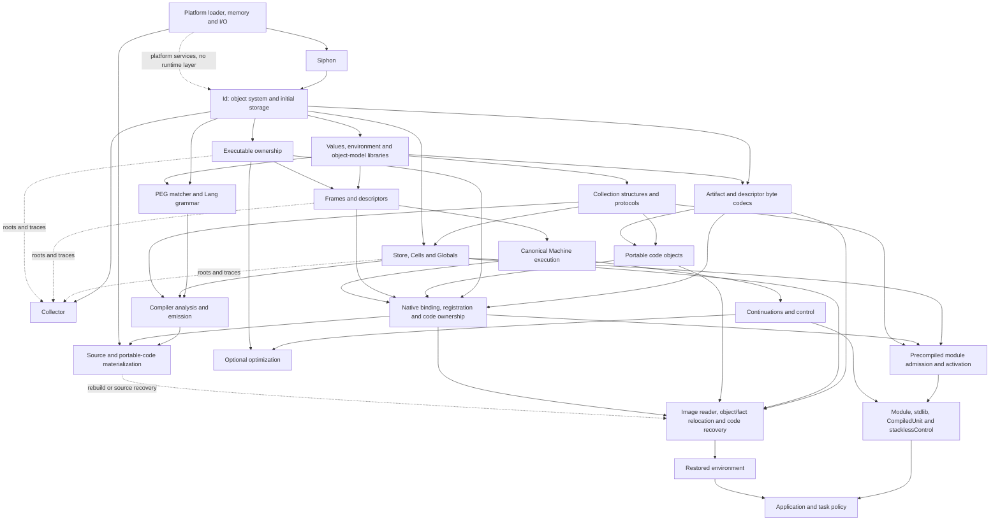

# 81B — Siphon handoff and construction graph

> **Superseded handoff proposal:** [Design 82](82-minimal-production-id.md) requires
> Siphon to use an ad-hoc Id loading API for the first load, followed by the real
> Id message API for subsequent modules. The separate Id-entry ABI and fixed C
> launcher proposal below are historical, not the current implementation plan.

> **Status:** Proposal, 2026-09-17. Step 1 of
> [81 — Toward a Birnam implementation](81-toward-a-birnam-implementation.md).
> Source observations checked against `8ab8d2a2`; no runtime implementation,
> new ABI, image-format change, or successful stage-1 bootstrap is claimed.
> [81A](81a-current-bootstrap-and-runtime-layers.md) records today's load order.
> The first semantic layer is Id; the subsequent thin layers are specified in
> [81C](81c-thin-id-runtime-layers.md).
> Updated direction: [81D](81d-id-api-partition.md) partitions IdApi for bottom-up
> extraction. Backward compatibility is not required; the earlier aggregate
> compatibility facade is dropped.
> 81D now proposes a Piumarta-grounded boundary with Symbol/interning in Id;
> exact interface contracts and semantic gaps remain to be resolved.
> For the production outcome through 81CA and current remaining work, see the
> [phase closeout](81-production-extraction-status.md). Historical next-step
> recommendations below do not constitute the current work queue.

## 1. Proposed boundary

The siphon loads the Birnam-authored Id module and calls its raw entry. Id
constructs its own object system and initial storage, then hands further bring-up
to loaded code. It is the first semantic layer: no Rust allocator, allocation
registry, object representation or other runtime sits beneath it. The siphon
does not initialize objects, construct an IdApi, run a compiler, interpret an
image, or select language methods.

Use a separate **Id-entry ABI**, independent of IdApi, for this first handoff. Ordinary
compiled modules continue to use the runtime interfaces after they exist.
Do not pass an incomplete IdApi full of Rust callbacks or placeholder functions
to the first component.

Initially implement the siphon as a small C launcher, with platform assembly
only if the entry boundary requires it. This avoids Rust runtime/library linkage
in stage 1. Its eventual compilation from Birnam is a separate small target;
it must still contain only the loading boundary. All Birnam system behavior
below and above ordinary message sending is implemented in loaded Birnam code.
Platform libraries and explicitly requested foreign libraries remain outside
that implementation-language claim. Generated C is an allowed stage-0 backend.

The first installed artifact remains the Id library, `lib/libbirnam_id.dylib`,
implemented in Birnam for the target system. It is not a new combined
Id/collector/execution boot runtime. The entry descriptor below is proposed;
the current Rust library does not export it.

## 2. Why an ordinary compiled module cannot be first today

These are current dependencies, not inherent requirements of a future backend:

| Current boundary | Services it already assumes | Consequence |
|---|---|---|
| Native rung `module_init(IdApi*, state)` | Initialized object model, allocation, symbols, exports and GC callbacks | Cannot construct the floor from a platform-only siphon |
| Generated C expressions | `birnam_send`, `birnam_intern`, boxed literals, globals and block construction | Even simple ordinary Birnam source presupposes a runtime |
| `__birnam_unit_init` | Interning imported global names | Mapping an ordinary module is not enough to make its initializer callable |
| Generated method installation | Private-vtable support, method/source registration and generation ownership | Admission/activation currently spans more than the public IdApi |
| Compiled artifact loading | Codegen's loader, binding, registration and ownership machinery | Merely precompiling the compiler does not remove this cycle |
| Birnam `Module` manager | Reflect, Store/db/Cells, Globals, collections, control and Artifact/Codegen protocols | Cannot manage the components needed to create those very objects |
| Source recovery | PEG/Lang, lowering, emission, materialization | Cannot be the first executable step unless those services were already brought up |
| Image recovery | Object allocation/relocation, stored code admission, ownership and, when present, Store and portable objects | An image cannot provide its own first executable reader |

Evidence: `C_RUNTIME_PRELUDE` and `TranslationUnit::finish` in
[codegen](../../rust/birnam-codegen/src/lib.rs); `artifact_source`,
`bind_global_shims` and `rust_codegen_load` in
[Codegen runtime](../../rust/birnam-codegen-runtime/src/lib.rs);
[IdApi](../../rust/birnam-abi/src/lib.rs);
[Module](../../modules/modules.birnam); and
[image construction](../../rust/birnam-image/src/lib.rs).

An important distinction: today's floor has a raw import/export namespace; the
ordinary `Globals` object and its Store-backed behavior are installed by
[Store](../../rust/birnam-store/src/lib.rs). In the proposed split, Id constructs
its own Symbols and interning; the general namespace mounts above Id.
Neither requires Store-backed Globals to exist first.

## 3. What the siphon does

Its complete proposed normal path is:

1. Obtain the actual executable location using the platform's path rules.
2. Locate the Id dylib at the installed executable-relative location. A test
   harness may supply an explicit Id path; ordinary application/configuration
   selection belongs to the loaded system.
3. Open that dylib with immediate symbol resolution and local visibility.
4. Resolve its fixed Id-entry descriptor export, check the entry ABI header and
   platform identity, and invoke its entry with raw process inputs.
5. Remain as a live outer native frame until the entry returns an exit status.
   Do not run a host event loop or route user commands after handoff.

The OS dynamic loader performs ordinary native relocations. The Id dylib and
its transitive dependencies must have no Birnam-runtime initializer constructors:
runtime construction begins at the explicit entry. This is a build/import audit
requirement, not a claim that `dlopen` can inspect arbitrary hostile libraries
without executing their constructors.

Before handoff, errors use a fixed raw diagnostic path and a nonzero process
status. No String, Error, logger, TOML parser or artifact parser is needed. Keep
the Id library mapped until process exit; the siphon must not unload it after
return while platform exit handlers might still hold its addresses.

### The handoff, in C notation

This is a proposed carrier shape, not a checked-in compatibility header. It is
initially specific to the supported arm64 macOS C ABI. Sizes, reserved bits and
platform identifiers must be frozen and fixture-tested when implemented.

```c
struct SiphonHostV1 {
    uint32_t version;
    uint32_t size;
    void *(*open_library)(const char *path, int flags);
    void *(*find_symbol)(void *handle, const char *name);
    int (*close_library)(void *handle);
    const char *(*loader_error)(void);
    void (*diagnostic)(const unsigned char *bytes, size_t length);
};

struct SiphonStartV1 {
    uint32_t version;
    uint32_t size;
    const struct SiphonHostV1 *host;
    int argc;
    const char *const *argv;
    const char *const *envp;
    const char *executable_path;
    const char *id_library_path;
    uintptr_t native_stack_anchor;
};

struct BirnamIdEntryV1 {
    uint32_t version;
    uint32_t size;
    uint32_t platform;
    uint32_t reserved;
    int (*run)(const struct SiphonStartV1 *start);
};

/* An inert data export, resolved on the exact Id-library handle. */
extern const struct BirnamIdEntryV1 birnam_id_entry_v1;
```

The siphon validates the fixed descriptor prefix before reading `run`: supported
version/platform, sufficient size, zero reserved fields, and a non-null entry.
Id checks the corresponding start/host prefixes before use.
The native library is a trusted build product; these checks diagnose incompatible
products, not arbitrary pointer corruption.

### Lifetime and operation contract

- All input structures, strings and argument arrays remain valid and immutable
  until `run` returns. Paths and arguments are native byte strings, not required
  to be UTF-8. The loaded system copies anything it needs beyond that extent.
- The outer stack anchor remains live across `run`. It is an address boundary,
  not an Oop or a guarantee that native roots are already traced. Register saving,
  native-root discovery and foreign reentry remain the loaded runtime's job.
- The loader functions have the supported platform loader's semantics. Handles
  returned to loaded code are owned by that code. It may close them only after
  code pointers, Frames, Blocks, callbacks and finalizers no longer require them.
- `loader_error` returns the platform's temporary error text; consume/copy it
  before another loader operation. `diagnostic` consumes borrowed bytes
  synchronously and retains nothing. The launcher supplies no allocator.
- Id resolves/imports the platform memory and I/O functions it needs. It
  implements its own object storage and allocation bookkeeping.
  Raw memory from the OS is not an object or a collector.
- `run` is entered once on the initial owner thread. Subsequent loaded layers
  own scheduling, worker creation and shutdown; they are not implemented in Id
  merely because execution begins at its entry. No exception/unwind crosses this C boundary.
  Normal return occurs after runtime cleanup; the status is a process exit code.

The initial Id entry deliberately does **not** accept image state as an Oop,
a prepopulated IdApi, a runtime callback table, or a Rust allocator. Image/source
arguments travel in argv; a later loaded bring-up coordinator interprets them. The
current baked-executable trailer can likewise be read by the loaded system from
the executable path. The siphon needs no image grammar.

## 4. The first loaded component and its construction phases

The first component is thin Id: object headers, vtables, delegation, method
dictionaries, ordinary lookup/send, identity, Symbol/interning and its
own initial object storage. Object-model libraries, values/environment, the
collector, executable ownership, Frames, Machine execution, continuations/control and optimization
are subsequent layers, as specified in 81C. There is no storage-runtime layer
under Id and no collector bundled into Id as a startup prerequisite.

The initial component may use direct lexical implementation calls and explicit
low-level operations to establish the graph. It may not compile ordinary sends
as hidden static calls to evade malleability. The exact facility for authoring
such code is Step 2, currently missing as a demonstrated compiler capability.
Construction helpers must not become a second hidden dispatch path after boot.

| Phase | Work permitted | Exit condition |
|---|---|---|
| Raw entry | Validate carriers, acquire OS memory, initialize private registries | Storage exists with an explicit owner; no ordinary sends or collecting allocation |
| Object construction | Create primordial object/vtable/selector identities and install lookup/allocation methods | A real ordinary send works without a collector, Store, compiler or Rust libid |
| Id ready | Expose the minimal Id construction/storage interface and hand off further bring-up | Subsequent layers can mount without assuming higher services exist |
| Later values/collector layers ready | Adopt initial identities; mount collection over tracked storage, layouts and roots | Reclamation is supported without a second object graph or a collector embedded in Id |
| Required services ready | Each mounted layer publishes its own required interface/protocol | Consumers receive the services they actually require, with no aggregate compatibility table |
| Loaded coordinator and support | Select the startup composition and load its required support | Ordinary module or image admission can begin |

Keep construction allocations stable. Record them from birth in the final
Id-owned allocation registry, with an explicit construction root set. Do not copy them
into a different heap or leak a permanent second graph when GC starts. Establish
normal layouts and roots before dropping temporary construction roots. The
later collector uses its own non-collecting work storage and does not depend on Store
or the user collection protocol to trace its first heap.

Minimize IdApi itself. Value, namespace, GC and platform services move to their
respective owners; the old aggregate table is not retained as a facade.
Consumers and their initialization contracts change with the partition in 81D.
Early mounting uses only the Id capabilities already present, with no placeholder
functions standing in for missing services. Exact carrier shapes remain design
work. Method/StepMethod and descriptor layouts need not change merely to remove
unrelated fields, but old IdApi layout compatibility is not an acceptance gate.

Early support layers must therefore expose construction entries that work with
the capabilities already present; they cannot use today's ordinary `module_init`
before its prerequisites exist. A loaded Birnam coordinator owns the support
inventory and sequencing after the initial Id handoff. Its early entry must obey
the same constraint, rather than moving the whole startup policy into Id.

The Id module's mapping remains pinned, but its ordinary methods still
participate in normal lookup/mutation. Process-lifetime code retention does not
make its method dictionaries immutable. Hot replacement of the physical heap
implementation or unloading the first component requires its own state-transfer
design and is not implied by this initial handoff.

## 5. Proposed dependency graph

Edges mean **must exist before this capability can execute**, not Cargo linkage
or a claim that every box is exactly one dylib. Every system box after the siphon
is Birnam-authored. OS/foreign services are shown separately.



This is a target decomposition. In particular, today's Codegen combines `K`,
`M`, `N` and much of `L`; separating them is required to realize the graph.
81C further decomposes today's libid state and distinguishes capability edges
from registrations with the collector. Platform services do not constitute a
semantic layer underneath Id. All ordinary reclamation-dependent execution
requires the collector to have mounted; dotted root edges do not make it optional
for that execution.
The current normal image route also invokes Codegen recovery on the mapped path,
so its actual support closure still includes compiler/materialization support.
The dotted edge is optional only after a separate compiler-free mapped recovery
path has been implemented and validated; it is not a claim about image v8 today.

### Why these edges exist

- **Id before Store:** pointer identity and method dictionaries establish
  dispatch without facts. Store projects and extends that environment afterward.
  Seed Store schema with the existing raw-append/flip approach before ordinary
  schema-aware writes. Do not reintroduce a Store dependency into primordial lookup.
- **Roots/GC before extensible subsystems:** Store, PEG, collections and code
  owners register the objects they retain. The collector uses registered tracing
  protocols; it need not be implemented in terms of Store. This revises the
  historical Design 30 ordering to match the current floor's ownership model.
- **Collections before the proposed Birnam Store:** reuse explicitly bootable
  storage structures instead of relying on Rust Vec/maps internally. This is a
  proposed implementation dependency, not today's native Store load order.
  Those initial structures use direct object fields/raw buffers, not Store Cells.
- **Portable/Frame metadata and ownership before selected code:** resume entries
  and closures require descriptors, roots and executable owners. Registration
  must not publish callable code before these requirements are satisfied.
- **Precompiled admission before the high-level Module manager:** a small loaded
  bootstrap coordinator activates an explicit support inventory. Once Module
  exists, it takes over general dependency policy using the same admission
  mechanism. The siphon contains neither inventory nor a second module manager.
- **Compiler independent of AOT activation:** loading already compiled code
  needs validation, binding and ownership, not source analysis. Extract those
  mechanisms from Codegen and give their consumers explicit service contracts.
  No early loader calls an uninitialized compiler.
- **PEG need not wait for Store:** today's PEG initializes pattern/CST objects
  through IdApi and trace hooks. Lang constructs its grammar through PEG sends.
  Source journaling and reflected compiler behavior subsequently need Store.
- **Selected library control after Machine support:** the existing
  stacklessControl policy can mount when descriptors/Frames exist. Earlier
  construction must use Birnam-authored primitive control, not Rust Prelude.
  Retaining genuinely used lower-level operations is different from retaining
  duplicate Rust implementations later overwritten at startup.

`Module`, `stdlib`, `CompiledUnit` and `stacklessControl` remain separate logical
modules. Their existing ordered initialization and initial-source inventory
requirements still apply; the grouped box is not a new combined artifact.

## 6. Images, dylibs and source share the handoff

All launch compositions enter the same `birnam_id_entry_v1.run`. The loaded
coordinator determines what support is absent and brings up the necessary
capabilities before restoring or activating application behavior.

| Composition | Executable support required before consuming it | Source behavior |
|---|---|---|
| Dylibs | Id, required runtime layers, artifact admission/binding, and each module's declared requirements | Compiler need not run just to activate precompiled code |
| Image | Id plus the separately loaded image restoration support closure | Retained source is preserved; compile it when recovery requires it |
| Image plus dylibs | Image support, then explicit dependency/generation-aware module activation | Added modules must not silently overwrite the image's generation |
| Image/dylibs plus source | Above support plus the loaded compiler/materializer | Compile source through that system and use ordinary publication rules |

An "image launch" still needs executable restoration support. For the first
implementation, the installation supplies Id and the required support dylibs even when
the application is entirely in an image. A self-contained packaging format may
later carry that same native support alongside the image; that is not a reason
to put an image decoder in the siphon. The current image file is not directly
loadable by the platform dynamic linker.

Loading restoration support is not running all default application initializers.
Support objects and recovered objects must reconcile canonical identities using
the existing image contract; do not create two independent heaps/Globals graphs
and arbitrarily choose one. Restoring a method/global, mounting a support module,
and applying a new application generation are distinct operations.

Process-local loader handles, callback trampolines, raw platform addresses,
native stack anchors and executable-owner bindings are reacquired after restore.
They are not made durable by retaining source. Foreign bindings and generation
pins must be ready before restored code can execute.

## 7. Where the cycles are broken

| Cycle | Proposed break | What must not substitute for it |
|---|---|---|
| Generated code needs the runtime it implements | Id-entry emission with explicit low-level operations and Id-owned construction functions | Hidden calls to Rust `birnam_send`/allocation or a storage runtime under Id |
| Vtable of the first vtable | Directly construct the finite primordial graph, then publish ordinary lookup | Parsing definitions through a nonexistent compiler |
| Allocation before collection | Id tracks stable construction storage; a later collector mounts through explicit storage/root interfaces | Rust allocation bookkeeping below Id, untracked objects or an unbounded permanent scratch heap |
| Store schema describes itself | Raw seed, then schema-aware operation | Store-dependent floor dispatch |
| Module manager needs modules already loaded | Birnam coordinator with explicit initial inventory over shared low-level admission | Rust host bootstrap or a second general resolver |
| Codegen loads the code that should implement Codegen | Separate precompiled admission/ownership from compiler analysis | Treating all of `birnam-codegen-runtime` as indispensable first-stage code |
| Image contains its own runtime/compiler | Executable Birnam restoration support starts outside the image | Expecting raw image bytes to invoke their decoder |
| Source contains the compiler | Load a compiled compiler or recover one with executable support first | Making Rust source evaluation a hidden installed fallback |

## 8. Step-2 capability findings and next bounded implementation

The existing Word and ForeignAddress objects do not prove pre-object execution
is expressible: constructing or sending to them already needs the runtime.
Likewise, Alien wrapping needs objects, compiler services and native binding.
The compiler must demonstrate the following facilities before the Id module
can be built from Birnam:

1. Export a plain entry/data descriptor with the C carrier layout and calling
   convention, without an ordinary module initializer.
2. Construct/read/write raw memory, perform word/address arithmetic and branch
   or iterate without boxed literals, selectors or Block allocation first.
3. Make local implementation calls and imported platform calls with defined
   layouts, lifetimes and error behavior.
4. Define primitive bodies whose ordinary published methods retain Id semantics;
   distinguish those explicit bodies from arbitrary sends that remain late-bound.
5. Emit complete dependency/import evidence, including compiler-generated helper
   calls. No optimization option may quietly add a Rust runtime dependency.

The present emitter has not been shown to support this mode. Design its syntax
and semantics in Step 2; do not prematurely select C-string injection, a second
source language, or selector-based magical lowering as the solution.

The first runtime proof should load the Birnam Id module, allocate its primordial
graph, install a method, send to an object, replace the method and observe the
new result. Demonstrate the intended object identities and temporary/root
ownership. It must run without the Rust floor or Tcc runtime dylib supplying
runtime services. C/libtcc may have produced the artifact during stage 0.

Initially this proves the raw-entry/object boundary only. Higher service
publication, GC closure, selected Frames, ordinary module admission and image
reconstruction have their own follow-on gates; no dummy aggregate API table
should disguise their absence in the first experiment.

## 9. Evidence required for the handoff

For the first implementation, retain evidence for:

- Exact boot ABI/version/platform rejection; no language initializer runs on a
  rejected handoff. Missing dylib/entry produces a raw startup diagnostic.
- Siphon imports limited to the declared platform loading/path/diagnostic set.
  No Rust startup, allocation, panic/unwind, compiler or Birnam semantic library
  is linked into it, including through transitive dependencies.
- Id-component source provenance and transitive import audit. Inspect generated
  helper calls as well as the visible entry function; merely renaming symbols
  or omitting "rust" from library names does not prove the boundary.
- Execution with stage-0 native libraries physically unavailable in an isolated
  prefix, and call/provider evidence for allocation, lookup, sends and replacement.
- Valid input/anchor lifetimes, bounded pre-GC allocation behavior, and eventual
  construction-root release. A trivial entry returning a constant is only an
  ABI smoke test, not runtime proof.
- Once supported: full GC/native reentry, selected-code ownership, and the four
  launch compositions, including source recovery and live replacement.

The cold build remains separate: source checkout and declared external toolchains
produce the stage-0 compiler, which builds Id and subsequent
Birnam artifacts. Installed-stage acceptance then hides those bootstrap runtime
products. Later compiler self-hosting adds successive-stage output and semantic
comparison; it does not replace the construction proof.

## 10. Decisions proposed and remaining work

Proposed now: a C-only siphon; an explicit, versioned entry to Id as the first
semantic layer; Id-owned primordial construction and initial storage; thin
subsequent layers rather than a combined boot runtime; minimal IdApi with
higher services published separately and consumers migrated without a facade;
shared precompiled admission separated from compiler analysis; and one handoff
for all image/dylib/source compositions.

The unresolved implementation decisions are the low-level Birnam authoring model,
the minimum Id implementation and its mounting/storage interface, the later
collector's attachment protocol, the extracted admission API,
and the smallest image-restoration support closure. They do not change the
siphon ownership boundary. Module packaging and compiler-free mapped recovery
must follow measured dependencies rather than be declared complete by this graph.

This proposal retains object identity, late-bound dispatch, Store history,
native participation and selected-frame ownership. The user explicitly allows
breaking IdApi compatibility to establish the smallest boundary; migrate
consumers and update ABI/admission evidence as part of that work. Unrelated
image-format changes are not required by this partition. The entry establishes
Id without a semantic runtime underneath it or an aggregate API above it.
