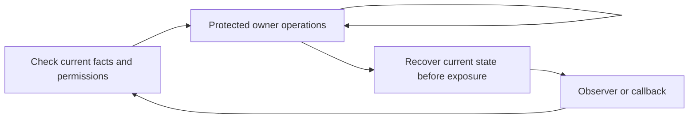

# Reusable behavioral proofs and conditional send bounds

Measurement-tool note (2026-10-28): the Operand/Outcome profiling runner and its
disconnected dispatch counters are retired. Commands below using that runner are
historical; use each report's measured revision to reproduce its results. Current
Oop checks include `scripts/oop-id-slice-bench.py` and the
`integer_performance` test. This note does not change the reported measurements.

The foundation is now in `formal/semantics`, with rooted-lifetime lemmas imported
from `formal/rooting`. It treats addition, boxed String byte length and Vector
access as acceptance examples. No arithmetic policy, Id ownership boundary,
public ABI, image format, root protocol or cold-bootstrap implementation changes.
No new production optimization is enabled by these framework proofs.

## Established rules

| Rule | Verified artifact | Obligations that remain with the producer |
| --- | --- | --- |
| Current meanings | `certified_dispatch`, replacement/revocation lemmas | List every lookup/parent/association/factory and permission dependency |
| Region validity | `unchanged_dependencies_preserve` | Prove intervening operations preserve relevant bindings and grants; data reads are separate dependencies |
| Protected invocation | `protected_inputs_survive` | Supply valid canonical live-value coverage at every safepoint and code/owner lifetime |
| Composition | `compose_refinement`, `sequence_refinement` | Instantiate a simulation relation preserving public state and identity, plus all ordered observations |
| Recovery | `recovery_preserves_prefix`, TLA exposure/replay cases | Prove a faithful concrete recipe before observation; no invented identity or replayed callbacks |
| Owner-message cost | `owner_boundary_lower_bound`, capacity-restricted variant | Fix operation vocabulary and allowed owner interfaces; include guard/control/GC overhead separately |

The observable trace includes lookup/mutation, identity, allocation hooks, ordered
root snapshots, frame snapshots with entered generation/continuation, finalizers,
user effects, errors and results. Equal output values are not sufficient.
Dropping a visible effect is formally rejected even if state and costs match.
The finite total-action semantics does not yet cover arbitrary divergence or the
entire Birnam interpreter. The observations and simulation relation are explicit
parameters; they must not be weakened to make a desired optimization pass.



A protected owner operation may still use Id. Its actual lookup and implementation
must both be known not to callback, collect or expose deferred state within the
certified interval. An ordinary unknown send is a boundary. Permission changes
without an epoch change are modeled explicitly. Active code remains the entered
generation; future sends use current meanings. The region model is for owner-thread
execution, not a concurrency proof.

## What the lower bound actually says

For a fixed sequence of required payload-owner operations, a schedule made of
positive-count homogeneous owner batches needs at least one send per consecutive
owner run. Lean proves this for arbitrary owner types and sequence lengths.
The supplied example schedules achieve that abstract lower bound.

| Successful kernel | Ideal owner-run floor | Example constraints |
| --- | ---: | --- |
| Addition | 3 | Integer reads twice; five Word operations; Integer result construction |
| Boxed String length | 2 | Bytes length; Integer boxing |
| Vector access | 2 | Integer index decoding; Vector-owned access |

These are not three-, two- or two-send implementations of the actual public
operations. Entry dispatch, observations, frames/control, guards, root ownership,
ABI wrapping, allocation admission and GC are excluded. The arithmetic kernel
assumes exact valid Integer operands, proper Error classification, no overflow,
current meanings and permitted observations. The Vector example also excludes
node/header validation costs. Concrete interfaces can require more: a checked
capacity-restricted addition schedule needs four payload-owner sends when Integer
access stays unary. We have not proved four to be the exact minimum of all current
interface implementations.

The important new capability is an explicit lower/upper-bound grammar. Future
minimum searches cannot silently introduce a universal `performEverything` owner
or read foreign payloads. An admissible emitted program supplies an upper bound;
proving impossibility below it requires the same interface and observation model.

## Real acceptance probes and causal graph

An optional Id census records parent/child selector counts plus receiver behavior
addresses at ingress. It reads only Id-owned metadata and sends no diagnostic
queries during the census. It is feature-gated out of the normal Id build.
Behavior addresses label ingress, not guaranteed semantic owners: custom lookup,
aliases and detached objects require interpretation. Unknown/detached receivers
are tagged zero. Borrowed snapshots are copied before another message.

Each measured call executes current owner interfaces and asserts the result.
The edge total exactly equals the selector census, and observed root tokens
balance. Both small probes are compiled with mask 31; they do not pretend to
compare different optimizers.

| Probe | Reference result | Current total Id messages per operation |
| --- | --- | ---: |
| Public addition chain | `12345 + 37`, repeated sixteen times | 3911.0625 |
| Captured `"hello" size` | 5 | 46 |
| Captured `#[11 22 33] at: 1` | 22 | 47 |

The wrappers and captured-variable retrieval are included. String and Vector
operation bodies are native today, while Integer policy is authored Birnam;
these numbers are not matched native/authored throughput comparisons.

The addition graph exposes large implementation cascades. Per addition:

- `intern:` causes 533 `symbolNamed:` calls.
- `at:` causes 163 intern requests and 163 symbol-name byte requests.
- `slotAt:in:put:` causes 117 identity queries, and `slotAt:in:` another 78.
- `canonicalBytesOf:` causes 104 intern requests.
- `fromMethod:codeObject:referenceSlots:` causes 103 intern requests.

These are aggregated direct edges, not exclusive CPU shares or exhaustive
per-source-span attribution. They nevertheless identify the representation,
Block/capture and ABI plumbing behind the selector histogram. A single ALU
addition is not what is repeatedly executed thousands of times.

The highest-value next candidates are dependency-certified owner regions for
Block/control and ABI adaptation, and reusable selector ownership/meaning proofs.
The generic theory is now available to express their conditions; it does not yet
prove that the entire helper call cascade can be collapsed.

## Evidence and commands

```sh
mise run formal-rooting
python3 scripts/microbench.py --case public-integer-retains --counts-only
python3 scripts/microbench.py --case semantic-string-length --counts-only
python3 scripts/microbench.py --case semantic-vector-access --counts-only
```

The permanent receipt is `docs/measurements/execution-semantics-20261007.json`.
Raw data is under `/tmp/birnam-semantics/`; fresh formal logs are under
`.cargo-target/formal/results/`. Counts are untimed; no long benchmark or startup
image rebuild is needed. Six deliberately broken region models and Lean mutation
checks exercise invalidation, observation, recovery, code lifetime, owner boundaries
and cost assumptions. They complement the actual Id edge/reset regression.

This is a reusable, checked foundation with an implementation correspondence
ledger. It is not a whole-language verification, a verified C/LLVM backend, a
runtime Frame-allocation removal or an exact total-send minimum for addition.

## First concrete slice: fixed ABI binding guard

Execution now offers the fixed `sendNativeTo:selector:arguments:signature:resultFactory:`
admission guard to Id as one `nativeBindingsMatch:` query. It replaces two separate
lookup/entry queries only when Id and GC have described the original implementations
in their proper roles and all four service meanings plus the target entry still
match. The method/context pair and default lookup are checked at Id. Changed
queries or interning fall back to the original order. Allocation permissions,
signature callbacks and the final epoch fence are still checked per attempt.
No dispatch executable or foreign payload/context is read by Execution.

`Admission.lean` proves guard-result preservation, role-domain fallback and the
conditional query cost. Failed batching adds a query before ordinary admission;
it does not have an unconditional send improvement theorem. `BindingAdmission.tla`
checks service callbacks, context equality, later revocation and later binding
mutation, with required broken-model counterexamples. Runtime tests cover the
corresponding owner declarations and replacement/GC paths. These are scoped
contracts and implementation checks, not a verified full-runtime translation.

The same sixteen-addition fixture, compiled with mask 31 on both sides, uses
Execution `bindingProofBatches:` to compare ordinary and batched guards:

| Metric | Ordinary | Batched |
| --- | ---: | ---: |
| Id sends per addition | 3911.0625 | 3890.0625 |
| Allocations / allocation charge | unchanged | unchanged |
| Remaining observed root tokens | 0 | 0 |

This removes 21 messages per addition (0.54%). A two-second paired timing run
reported no meaningful difference; this is not a fix for the large addition
slowdown. The main Block/capture and ABI construction cascades remain the next
priority. Dynamic Word-helper selectors and Block/Frame allocations are unchanged.
The reproducible case is `public-integer-bindings`; the permanent receipt is
`docs/measurements/abi-binding-admission-20261007.json`. The diagnostic prefix is
isolated, and the installed binary/images are not rebuilt by this work.

The subsequent [ABI investigation](abi-overhead-investigation.md) adds matched
carrier/leaf controls and disjoint message ancestry. The warmed addition census
places 278 sends in three named outgoing ABI subtrees out of 3889.75 total sends
per addition. Its dominant bridge components are fresh permission and signature-
owner checks, followed by boxing. These are message counts, not CPU shares or
whole-runtime minima; no new runtime optimization is enabled by that investigation.
