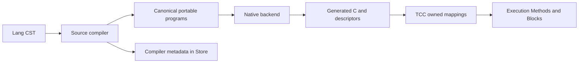

# Native module decomposition roadmap

Updated: 2026-10-02.

All five decompositions below are agreed directions. Start with **source compiler
and native backend**. This document tracks extraction, acceptance and later Birnam
replacement separately. The order after the first extraction is the recommended
sequence and can change as dependencies become clearer.

The goal is to give each native module one complete responsibility, a small
Id-message interface and ownership of its own state. That makes it possible to
replace its implementation with Birnam independently. Moving Rust files or making
another crate that borrows the old owner's state does not complete a decomposition.

The first delivery batch includes the HostEntry, HostInteraction and HostProject
owners, NativeBackend, Generation and ProjectBuild. Extractions 1–3 are
implemented and validated; extractions 4 and 5 remain queued.

## Order and status

| Order | Decomposition | Extraction | Birnam replacement |
| --- | --- | --- | --- |
| 1 | Source compiler and native backend | Implemented and validated | Planned after extraction |
| 2 | Compilation and generation publication | Implemented and validated | Existing CompiledUnit policy stays Birnam; remaining bookkeeping can follow |
| 3 | Project observation and project build | Implemented and validated | Build sequencing and publication construction are initial targets |
| 4 | Alien wrapper compiler and Alien runtime | Queued | Best smaller independent rewrite; may move earlier after the first extraction |
| 5 | Image format and image restoration | Queued | Format implementation follows extraction and performance validation |

Update each row when work starts. An extraction is complete only when production
callers use the new native owner through Id, its acceptance checks pass, and the
displaced implementation path is removed. Record the commit and evidence location
when it is delivered. A Birnam replacement is a separate milestone.

## Rules shared by every decomposition

- Each new native owner has the standard module descriptor, explicit completed
  inputs and its own state. Native consumers use current Id lookup.
- Transfer ordinary Objects or canonical bytes. Keep Rust IR, private payload
  layouts, native capabilities and mutable state borrows inside their owners.
- Preserve creating-thread execution, exact roots across effectful sends, copied
  byte borrows, error behavior and existing observation order.
- Compiler-produced metadata stays in Store. Compiled startup rejects missing or
  malformed metadata; it never parses source as a fallback.
- Keep TCC's mapping ownership and Execution's Method, Block, frame and active-code
  retention. Preserve idle publication and delayed physical reclamation.
- Reuse existing algorithms and authored policy. Add no parallel resolver,
  generation model, generic service catalog or second runtime.
- First extract with behavior unchanged. Then replace one implementation with
  Birnam, using the same externally observable acceptance checks, and remove the
  displaced Rust implementation.

These extend the existing [functional ownership contract](90-functional-modules.md).
Role names below describe proposed ownership; final receiver, crate and selector
names remain implementation decisions.

## 1 Source compiler and native backend

### Responsibility

The source compiler owns source/CST interpretation, semantic lowering, source
identity, embedded-file inventory, compiler metadata production and diagnostics.
The native backend owns portable-program lowering, private IR, slot allocation,
frame and selection descriptors, optimization construction and C emission.
TCC continues to compile and own native mappings. Execution continues to own
executable Methods, Blocks and their lifetime.

The existing canonical portable-program format provides the main seam. The
backend must accept every supported compilation mode without receiving a Rust
`Program`, CST, IR or reference to Codegen's aggregate state. Original source and
filename provenance, root-binding persistence, capture semantics and factory
selection must survive the extraction.

### Implementation sequence

- [x] Identify the existing portable-program seam and its production consumers.
- [x] Inventory ordinary source compilation/evaluation, emitted C, source
  artifacts, named adapters, synchronous/resumable materialization, candidate
  factories and image bundles. Record each mode's inputs and observable behavior.
- [x] Finalize the smallest value/byte interface covering those real consumers.
  Preserve the existing canonical formats; keep backend IR private.
- [x] Extract one complete native backend owner with descriptor, construction,
  rooting and error handling. Retain current emission algorithms.
- [x] Route every native emission consumer through Id. Move typed Rust helper
  dependencies behind the owner and remove production bypasses.
- [x] Update Bootstrap/build/install/export inventories and verify the actual
  installed library and executable-relative loading.
- [x] Complete acceptance and record delivery evidence.
- [ ] Convert source lowering and metadata production to Birnam while retaining
  the native backend. A backend rewrite can follow independently.

This first extraction does not redesign generation publication or replace the
compiler frontend simultaneously. It establishes the seam those later migrations
will consume.

### Acceptance

Retain canonical portable fixtures and independent codec checks. Exercise source
compilation/evaluation, artifacts, named methods, materialization, candidates and
image code through the installed backend. Preserve nested captures, global versus
lexical bindings, numeric bits, diagnostics/provenance, evaluation effects and
synchronous/resumable capture observation order.

Run the relevant compiler, artifact, portable execution, materialization,
recovery/frame and image integration checks, plus workspace and installed Host
checks. Prove TCC reclamation after the last live executable references disappear.
Keep parser/compiler-disabled compiled startup and malformed-metadata refusal.
Compare canonical programs and behavior; generated C includes provenance, so
byte equality alone is not an adequate equivalence test.

Sources: [source compiler facade](../../rust/birnam-codegen-runtime/src/lib.rs),
[semantic lowering](../../rust/birnam-codegen/src/lib.rs),
[native emission](../../rust/birnam-native-backend/src/native.rs),
[resumable lowering](../../rust/birnam-codegen/src/resumable.rs),
[metadata persistence](../../rust/birnam-codegen-runtime/src/source_metadata.rs).

### Extraction checkpoint: 2026-10-02

Implemented `birnam-native-backend` as a separately loaded native owner. Production
emission and descriptor requests cross Id using canonical program bytes and
ordinary Objects. The existing C emission algorithms were retained. Bootstrap,
installation and export inventories include the new library. This work and the
preceding Host extractions are included in the first delivery batch.

Validation passed: workspace tests, the full native message suite, installed CLI
checks, generation/image publication checks, compiled startup with emission
messages disabled, and a focused backend rooting/error-propagation check. Four
representative emitted C comparisons matched the preceding installed compiler.
The complete authored-language suite and doc generation were not rerun for this
checkpoint.

Evidence logs are retained locally in
`.cargo-target/measurements/native-backend-20261002/`. The clean installed test
prefix is `/tmp/birnam-decomposition/backend-clean-prefix`.

The full native suite was disproportionately expensive for this checkpoint:
individual image checks took 20–48 minutes, including nested restoration checks
that force precise collection after restored slots. Later extractions should
start with focused acceptance and report a checkpoint before broad validation.

## 2 Compilation and generation publication

Extract generation admission, candidate preparation, commit, exact inverse
publication, compensation, rollback, mutation authorization and generation
recovery from Codegen's aggregate state. Keep these transitions together under
one native owner. Codegen supplies compiled code and metadata; Store retains
durable records; TCC and Execution keep their existing resource ownership.

CompiledUnit, DispatchGeneration and EvolutionIntent already express policy in
Birnam. Preserve that policy and reconnect it to the extracted mechanism. Later
Birnam work can replace ledger and transition bookkeeping without changing source
compilation. Native enforcement of idle admission and exact ownership remains
where required until an equivalent replacement is proven.

- [x] Identify complete transition state and interactions with source registration
  and Image; resolve dependencies without exposing Codegen's Rust state.
- [x] Extract one owner and move all publication consumers to its Id interface.
- [x] Preserve the existing authored policy and remove the old mechanism path.
- [x] Validate and record delivery; track subsequent bookkeeping replacement.

Acceptance includes candidate, generation, ledger, transaction, retirement and
Store compensation checks; installed CompiledUnit and console/TCP intent checks;
and composed-image recovery. Preserve refusal during entered execution, stale
preparation refusal, callback/observer failure compensation, exact rollback and
reclamation only after old executable references are gone.

Sources: [candidate state](../../rust/birnam-generation/src/candidate.rs),
[ledger](../../rust/birnam-generation/src/candidate_ledger.rs),
[transactions](../../rust/birnam-generation/src/candidate_transaction.rs),
[authored policy](../../modules/compiled-unit.birnam).

### Extraction checkpoint: 2026-10-02

`birnam-generation` now owns candidate state, preparation, publication, inverse
ledgers, compensation, retirement, running admission and recovery. Source
registration and the staged registry exchange moved with the ledger, preserving
atomic native ownership updates. Codegen retains compilation, canonical metadata
production and candidate inventory lowering. All publication callers use
Generation through Id; the old Codegen publication methods were removed.
CompiledUnit, DispatchGeneration and EvolutionIntent retain their authored policy.

Focused validation passed: 71 pure compiler tests; candidate admission; retirement
in bootstrap/running phases; compiler execution; canonical initial projection;
ledger drift/adoption; generation transaction compensation and exact rollback;
Store compensation; installed console/TCP activation and rollback; 57 CompiledUnit
policy checks; composed-image mapped/rebuilt/resaved recovery and compensation;
and parser/compiler/emission-disabled startup. The native export, install-name
and dependency audit passed for the fresh 44-library prefix. The native focused
checks took seconds each; the composed-image test took about 87 seconds including
its subprocesses. No full native suite, exhaustive per-slot image GC suite,
authored-language suite or doc generation was run for this extraction.

The focused checks caught and corrected a mutation-refusal diagnostic change;
rejection once again leaves Codegen's compiler error untouched. Image test hooks
now target Generation's adoption method.

Changes are included in the first delivery batch. Evidence is retained locally in
`.cargo-target/measurements/generation-20261002/`; the disposable installed prefix
is `/tmp/birnam-publication/prefix`. Subsequent Birnam bookkeeping replacement
remains planned.

## 3 Project observation and project build

Keep project observation responsible for read-only discovery, manifest/source
context and dependency observations. Extract project build as one owner for
compilation sequencing, reuse validation, generated module/configuration/application
construction, staging and publication. ProjectPolicy continues to decide provider
selection, dependency order and compile-versus-reuse policy.

Published application entry should use existing HostEntry. LSP owns editor entry
and asks Project for observations through messages. Prefer removing the scoped
LSP callback/startup detour over introducing another permanent native LSP owner.
Dependency acquisition remains an explicit fetch operation; observation stays
offline and does not execute native build commands.

- [x] Separate observation from build/publication state and effects.
- [x] Extract the build owner and reconnect CLI, test and installation consumers.
- [x] Remove LSP startup from Project while preserving project-aware diagnostics.
- [x] Validate and record delivery.
- [ ] Move build sequencing and generated publication construction to Birnam,
  retaining the necessary filesystem/process effects for atomic publication.

Acceptance covers check/build/run/fetch/install/test, dependency/provider errors,
compile-versus-reuse identity, a failed stage preserving the previous publication,
published execution after deleting source, and LSP workspace/UTF-16/diagnostic
behavior. Preserve precise collection and callback revocation while removing the
old bridge, then test the new project-query interface directly.

Sources: [project operations](../../rust/birnam-host-project/src/project/operations.rs),
[publication construction](../../rust/birnam-project-build/src/project/data.rs),
[filesystem effects](../../rust/birnam-host-project/src/project/files.rs),
[ProjectPolicy](../../modules/project-policy.birnam),
[LSP](../../modules/lsp.birnam).

### Extraction checkpoint: 2026-10-02

`ProjectBuild` now owns compilation checks, build/reuse sequencing, generated
publication construction, staging, explicit dependency fetch, install and project
run/test orchestration. `HostProject` retains read-only discovery, manifest/source
observations, dependency/cache inspection and policy resolution. Build consumes
owned snapshots, manifests, paths and source metadata through current Id queries;
no observation implementation or private state crosses that boundary.

The original Birnam ProjectPolicy remains in charge of provider selection,
ordering and compile-versus-reuse decisions. Shared local Rust value contracts,
policy projections and bounded Git utilities live in `birnam-project-support`,
which has no native owner or mutable project state. Publication construction and
write effects remain private to ProjectBuild. Published execution still uses
HostEntry and existing HostInteraction.

LSP now calls HostProject's permanent `pathForUri:` and `snapshotForUri:` messages.
The old borrowed callback bridge, temporary Project global, revocation guard,
HostProject `lsp:` entry and HostInteraction `cliDirect:` detour were removed.
The replacement query test checks precise collection, retained receiver use,
malformed URI/arity handling, no source evaluation and no project build/cache
writes. No stack-borrowed callback remains to revoke.

Focused validation passed: 30 scoped unit tests; the native-owner descriptor,
reload and collecting-error checks; source-observation and policy collection
checks; permanent query collection checks; the installed project workflow smoke
(check/build/run/fetch/install/test, reuse/repair, failed-stage preservation,
source-free published execution, path/transitive native dependencies and pinned
Git acquisition/cache validation); and LSP workspace, diagnostics, UTF-16,
versioning/navigation and close behavior. The 45-library native export,
install-name and dependency audit passed. No full native suite, exhaustive image
GC suite or unrelated compiler/generation tests were run.

Native VM fixtures require fresh processes. A combined ignored-test invocation
hit the existing singleton/thread initialization restriction; the permanent query
case passed when run separately, as the validation script requires.

Changes are included in the first delivery batch. Evidence is retained locally in
`.cargo-target/measurements/project-split-20261002/`; the disposable installed
prefix is `/tmp/birnam-project-split/prefix`. Build sequencing/publication
construction in Birnam remains a subsequent migration.

## 4 Alien wrapper compiler and Alien runtime

Extract signature parsing, deterministic ABI classification and wrapper/callback
source generation into an independently loaded wrapper compiler. Keep foreign
addresses, library handles, address membership, callback roots and wrapper
mapping lifetime with Alien runtime. TCC remains the authority for platform ABI
size, alignment and calling convention.

- [ ] Extract the wrapper compiler and reconnect runtime and image consumers.
- [ ] Validate and record delivery.
- [ ] Replace signature parsing and wrapper-source generation with Birnam.

This is the preferred smaller rewrite after the first compiler extraction if an
early conversion is useful. Acceptance includes malformed signatures/identifiers,
scalar and aggregate calls, callbacks in both directions, pointer membership,
collecting callbacks, actual wrapper lifetime and mapped/rebuilt/baked recovery.

Sources: [signature grammar](../../rust/birnam-alien/src/lib.rs),
[ABI metadata](../../rust/birnam-alien/src/abi.rs),
[source generation](../../rust/birnam-alien/src/codegen.rs),
[runtime ownership](../../rust/birnam-alien/src/runtime.rs).

## 5 Image format and image restoration

Extract encoding and structural validation as one complete format owner. Keep
live heap restoration, Store exchange, source/binding publication, generation
adoption and compensation as one restoration transaction. Code staging continues
to consume the compiler/backend and generation-publication owners.

- [ ] Define the complete pure format responsibility and its validated data seam.
- [ ] Extract it without changing frozen bytes, bounds or admission rules.
- [ ] Validate and record delivery.
- [ ] Replace format implementation with Birnam and measure startup/load cost.

Acceptance includes frozen v8 fixtures, malformed/truncated records, references
and checksums; forced collection during restoration; mapped/rebuilt loading;
partial failure compensation; and stable repeated resaves. A Birnam replacement
must preserve bounded parsing and must be measured through usable startup as well
as isolated format operations.

Sources: [format proof](../../rust/birnam-image/src/v8.rs),
[snapshot and restoration](../../rust/birnam-image/src/native.rs),
[retained facts](../../rust/birnam-image/src/retained_facts.rs).

## Responsibilities to keep together

Execution's frame arenas, Methods, continuations, drive stops, guards and recovery
share exact ownership and lifetime. Improve private Rust structure while retaining
one native owner. Splitting these into separately loaded modules would make the
interface larger and move private capabilities across it.

Keep Artifact's related format codecs cohesive. Do not create one native module
per record, cache or helper. After backend extraction, materialization orchestration
and cache policy are a plausible small Birnam conversion; a separate materialization
library is not a prerequisite for this roadmap.

## Delivery record

For each delivered extraction or rewrite, append its commit, installed prefix or
artifact, acceptance evidence, remaining limitations and removal audit here. Keep
the order/status table current. The first delivery batch is committed on main with the Host and first three
extractions. Evidence and disposable prefixes are recorded in their checkpoints.
The commit identifier will be recorded with the next delivery batch.
